# MacLister

A lister-based file manager for macOS in the spirit of **Directory Opus Magellan**: double-click the empty
desktop and a file lister opens right where you clicked. Native Swift (AppKit + SwiftUI), runs as a
menu-bar app with an optional Dock icon.

**Language:** English · [Polski](README.pl.md) · **Website:** [maclister.github.io](https://maclister.github.io/)

<p align="center">
  <picture>
    <source media="(prefers-color-scheme: dark)" srcset="docs/screenshots/lister-pair-dark.jpg">
    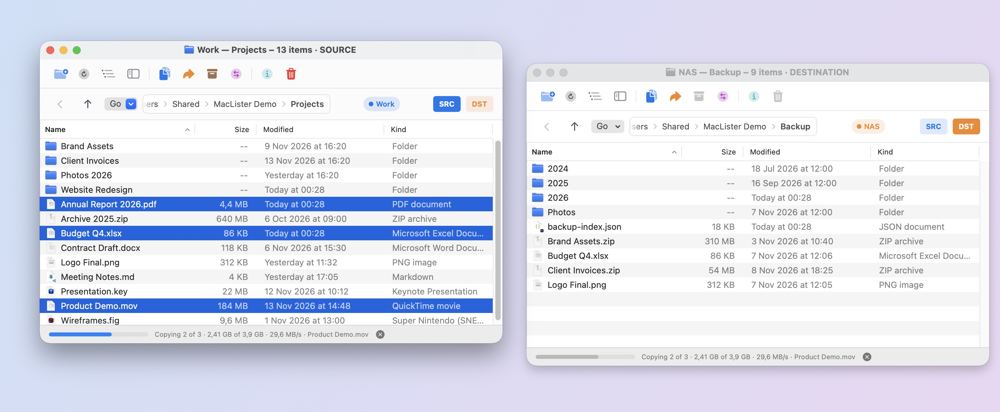
  </picture>
</p>
<p align="center"><sub>Source and destination listers with names, colours and a copy in progress. All files in the pictures are made up.</sub></p>

## Highlights

- **Desktop double-click opens a lister** at the cursor. Any number of listers at once.
- **Source / destination listers** with Copy (F5), Move (F6), Extract, Compare, Swap.
- **Drag and drop** between listers and to/from Finder (Finder rules: same volume moves, ⌥ copies, ⌘ moves).
- **Configurable button bar**, **filetype actions** (what a double-click does), **bookmarks**, **saved layouts**.
- Select by pattern, filter, **find** (Spotlight or a folder scan), **find duplicates**, **checksums**, folder sizes, info panel, rename, duplicate, Quick Look on Space, archive extraction
  (zip, tar.\*, 7z, rar, gz, bz2 …) and **browsing archives like folders**.
- **Right-click the title bar** for lister commands (duplicate, source/destination, close all …).
- **Undo** for the last copy, move, duplicate or Trash (⌘Z) and an **operation log** with a retention limit.
- **Drag-select** (press on a row and drag down or up to select the rows in between), **Tab** between listers, a **history
  menu** under right-click on Back.
- **Left, right and middle click** of every button can do something different; a **button editor** and a
  **title format** with `%` variables.
- **Update check** — manual, or automatic if you agree (off by default).

## Requirements

macOS 13 Ventura or later. Apple Silicon or Intel (universal build; the Intel half has not been run on real
Intel hardware).

## Install

1. Download `MacLister-<version>-macos.zip` from the **Releases** page of this repository. Optionally verify it
   against the `.sha256` file: `shasum -a 256 -c MacLister-<version>-macos.zip.sha256`.
2. Unzip it and drag **MacLister.app** into `/Applications`.
3. **First launch.** The app is ad-hoc signed, not notarized, so Gatekeeper blocks it at first:
   - Control-click the app → **Open** → **Open**, or
   - System Settings → Privacy & Security → **Open Anyway** (macOS 15 and later), or
   - run `xattr -dr com.apple.quarantine /Applications/MacLister.app` once.
4. **Grant two permissions** in System Settings → Privacy & Security:
   - **Accessibility** – to recognise what is under the cursor (empty desktop vs. icon, window, Dock).
   - **Input Monitoring** – macOS requires it for the passive event tap that sees double-clicks.

   Switch both on for MacLister, then **quit and start the app again** (menu-bar icon → *Quit MacLister*).
5. Click the menu-bar icon. The first line should read **Desktop double-click: active**.
6. *Recommended:* turn off the system's "reveal desktop" feature, otherwise the first click of a double-click
   slides all windows aside and the new lister can end up partly off-screen.
   System Settings → Desktop & Dock → **Click wallpaper to reveal desktop** → *Only in Stage Manager*, or:

   ```bash
   defaults write com.apple.WindowManager EnableStandardClickToShowDesktop -bool false
   ```

7. *Optional:* start at login via System Settings → General → Login Items → **+** → MacLister.

**Uninstall:** quit from the menu-bar icon, delete the app, remove `~/Library/Application Support/MacLister`,
run `defaults delete com.example.MacLister`, and remove MacLister from the two Privacy lists.

## Using MacLister

### Opening a lister

- **Double-click an empty spot on the desktop.** Nothing happens on icons, windows, the menu bar or the Dock,
  and clicks with ⌘/⇧/⌥/⌃ held are ignored. Prefer the mouse wheel? **Settings → General → Open a lister with** lets a
  **single click of the middle button** open a lister instead of, or in addition to, the double-click.
- Or use the menu-bar icon → **New Lister**.
- By default the window's top-left corner sits on the click; **Settings → General → Center the lister on the pointer**
  centres it instead. A lister opens on your home folder (see *startDirectory* below).

### Anatomy of a lister

- **Path bar:** *Back*, *Parent*, the **Go** menu (places, volumes, bookmarks, recent folders), the path as a
  clickable **breadcrumb** (click a folder to jump there; click the empty part of the bar or press **⌘L** to
  type a path instead, `~` works) and the **SRC** / **DST** badges.
- **File list:** icon, name, size, modified date. Click a header to sort; folders come first by default, or switch *Keep folders above files when sorting* off (Settings → Listers, or the column header menu) to sort folders and files together.
  Double-click or Return opens a file or enters a folder. **Right-click the column header** to choose the
  columns: Size, Modified, Created, Kind, Extension, Permissions, Tags, Comment. The widths you drag are remembered
  (Name always takes the space that is left).
- **The list refreshes itself** when files are added, removed or changed on disk (FSEvents), and the window
  subtitle shows the free space of the volume.
- **Button bar** above the path bar, as in Ambient on MorphOS (see *Configuration*): icons only, the name is in
  the tooltip. **Settings → Buttons → Button bar** puts it above the path, below the path or at the bottom;
  **Show Button Labels** adds text.
  A button can have a **menu of more actions**: hold it down for a moment and the menu opens (a plain click still does
  the button's own action). *Edit Buttons…* sets the entries; *Show an arrow on buttons that have a menu* in
  **Settings → Buttons** adds an arrow that opens the menu with one click, and *Menu opens* chooses whether it opens
  below or above the button (automatic: above when the button bar is at the bottom).
- A thin **status line** at the bottom: item count, selection size, filter, progress and errors.
- An optional **sidebar and folder tree** on the left (⌥⌘T, or *Show Folder Tree* in the menus). It has what Finder's sidebar has, read from Finder itself so the two stay the same: *Recents*, *Shared*, your *Favorites*, the *Locations* (iCloud Drive, home, disks, AirDrop, Trash) and your *Tags* (a click shows the files with that tag; *All Tags…* lists the rest). Below them is the tree: your home folder and every volume, folders only. Choosing a folder shows it in the lister, the tree follows the lister, new folders appear in it, and files dropped on a folder are copied or moved there like any other drop. The width you drag the divider to is remembered.
- New listers open at 560 × 400 and remember the size you last gave a lister by dragging its edge.
- The window subtitle shows the item count and the lister's role (SOURCE / DESTINATION).

### Source and destination

Mark one lister as **SRC** and another as **DST** with the badges in the path bar (click again to clear). You do not
have to: **the first lister you open is the source and the next one the destination**, and when one of them is closed
the gap is filled: the destination becomes the source and the next lister the destination (a locked one stays as it is). **Settings → General → First lister is the source, the
next the destination** turns this off. A saved layout brings its own roles back.
Then:

| Action | What it does |
|---|---|
| **Copy** (F5) | copies the selection of the source lister into the destination lister's folder |
| **Move** (F6) | moves it there |
| **Copy As** (⇧F5) / **Move As** (⇧F6) | the same, but first asks for a new name for every item, so the copy or move and the rename are one step; without a destination lister the copy goes into this folder |
| **Extract** (⌘E) | unpacks selected archives into a new sub-folder of the destination folder |
| **Compare** | selects, in both listers, items that are missing on the other side or differ (size / newer) |
| **Synchronize…** | compares the two folders including everything below them and shows a list of what would be copied (or sent to the Trash); you tick what to do |
| **Swap** | exchanges the roles |
| **Open in New Lister** | context menu, or **Shift + double-click** on a folder: opens it in a new lister beside this one |
| **Open in Destination** | context menu: shows the selected folder in the destination lister |

If no lister is marked SRC, the lister whose button you pressed is the source.

**Progress and Cancel.** Copy and Move show a progress bar in the status line (item, bytes, current file) with a
**Cancel** button; folders are processed file by file, so cancelling takes effect between files. A move on the
same volume is a plain rename.

**Conflicts** are asked one at a time, with the old and new size and date: **Replace** (the old item goes to the
Trash), **Replace If Newer**, **Keep Both** ("name 2.ext"), **Skip**, **Cancel**, and **Merge** when a folder
meets a folder (its contents are then resolved item by item). Tick **Apply to all remaining conflicts** to stop
being asked.

**Synchronize** works on the folders of the source and destination listers (both local). *Update the destination from
the source* copies new files and files that are newer in the source (an option also replaces files that are newer in the
destination, another moves files that exist only in the destination to the Trash); *Both ways* lets the newer file win in
each direction and copies one-sided files across. Nothing happens before you press **Synchronize**: the list shows
every planned step with a tick box. A replaced file goes to the Trash first, copies keep their dates (so the next
comparison is clean), and the operation is in the log and can be undone with ⌘Z (files moved to the Trash by the
*only in the destination* option are not part of Undo; take them out of the Trash). Empty folders are not copied.

**Lock Role** (title-bar menu, or ⌥-click / middle-click / right-click on the **SRC** / **DST** button) pins a lister as source or
destination: no other lister can take the role, it cannot be cleared or swapped away until you unlock it. ⌥-click on
a button the lister does not hold yet takes the role and locks it in one go.

### Keyboard

| Key | Action |
|---|---|
| Space | Quick Look (arrows move through files, Space closes) |
| Return, ⌘↓ | open file / enter folder |
| Backspace, ⌘↑ | parent folder |
| ⌘⌫ | move selection to the Trash |
| F2 | rename (with several items selected: batch rename) |
| F5 / F6 | copy / move to the destination lister |
| ⌘E | extract archives |
| ⌘I | info (size, dates, permissions, owner) |
| ⌥⌘I | edit attributes (permissions, dates, hidden, tags, comment) |
| ⌘L | type a path instead of using the breadcrumb |
| ⌘D | duplicate the selected files (`name copy.ext`) |
| ⌥⌘D | **duplicate this lister** (same folder, size, sort, filter) |
| ⌘F | filter by pattern |
| `+` / `-` / `*` | select by pattern / deselect by pattern / invert selection |
| ⌘A | select all |
| ⌘B | bookmark this folder |
| ⌘⇧. | show or hide hidden files |
| ⌘⇧L | bring all listers to the front |
| ⌘W | close the lister (with tabs: the tab) |
| ⌘T | new tab on this folder (when tabs are on, see [Tabs](#tabs)) |
| ⌃Tab / ⌃⇧Tab, ⇧⌘] / ⇧⌘[ | next / previous tab |
| ⌘Z | undo the last copy, move, duplicate or Move to Trash (this session) |
| Tab / ⇧Tab | move to the next / previous lister |

On many laptops F-keys need **fn**.

### Menus

- **Right-click the file list** – laid out like Finder's menu; the commands you use less often are in submenus so the
  menu stays short. On top: *Open*, *Open With*, *Extract*, **your own entries for the file's filetype** (see *Filetypes*), Copy/Move to the destination lister, **Move to Trash**
  (with its icon), *Info*, *Rename*, *Quick Look*, *Copy* (puts the files on the pasteboard), *Copy Path*, then the
  submenu **Details** (*Attributes…*, *Checksums…*, *Calculate Folder Size*, *Tags…*) and **Make** (**Compress** –
  `name.zip`, or `Archive.zip` for several items –, *Duplicate*, *Make Alias*, *Make Symbolic Link*, *Copy As…*,
  *Move As…*), then **Share** (the system sharing menu), a row of **coloured tag dots**, **Quick Actions** (rotate,
  create PDF and convert for images, plus your Automator Quick Action workflows from `~/Library/Services`) and
  **Services** (whatever the installed services offer for the selected files, e.g. “New iTerm2 Tab Here”),
  *Open in New Lister*, *Open in Destination*, *Reveal in Finder*, and **This Lister** (*New Folder…*, *New Text File*, *Terminal Here*,
  *Show Hidden Files*, *Refresh*, *Snapshot This Folder*, *Add to Dock…*, *Show Folder Tree*, *Duplicate Lister*, *Name This Lister…*,
  *Add Bookmark*). Clicking empty space gives the folder commands: the submenu **Select** (by pattern, by attributes,
  all, invert), Filter, Find, Find Duplicates, Flat View, Calculate Folder Sizes, Compare and Synchronize with the
  destination, New Folder, New Text File, Terminal Here, Copy Folder Path, Hidden Files, Refresh, and **This Lister**.
  Tag dots toggle a colour on every selected item (a dot with a check mark means all of them have it); *Tags…* adds
  and removes any tags, coloured or not.
- **Right-click the title bar** (or Control-click) – lister commands, with the less common ones in submenus:
  *Parent*, *Back*, *Refresh*, **Bookmarks** and **Recent Folders**; **View** (*Show Hidden Files*, *Filter…*, *Flat View*,
  *Show Folder Tree*); **Search** (*Find…*, *Find Duplicates…*); **Source and Destination** (*Set as Source*, *Set as
  Destination*, *Lock Role*, *Swap*); *Undo*, *Operation Log…*, *Connect to Server…*, *Terminal Here*; **Lister**
  (*Duplicate Lister*, *Name This Lister…*, *New Lister*, *Lister Title…*, *Snapshot This Folder*, *Add to Dock…*, *Keyboard
  Shortcuts…*); **All Listers** (*Bring All Listers to Front*, *Move All Listers to This Desktop*, *Close All Listers*,
  *Save Layout*, *Restore Layout*); *Close Lister*.
- **Menu-bar icon** – list of all open listers (click to bring one to the front; roles are shown as
  \[SRC\] / \[DST\]), Bring All to Front, Close All, *Duplicate Frontmost Lister*, layouts, *Undo*, *Operation Log…*,
  *Check for Updates…*, **Settings…** (⌘,), permission status.

<p align="center">
  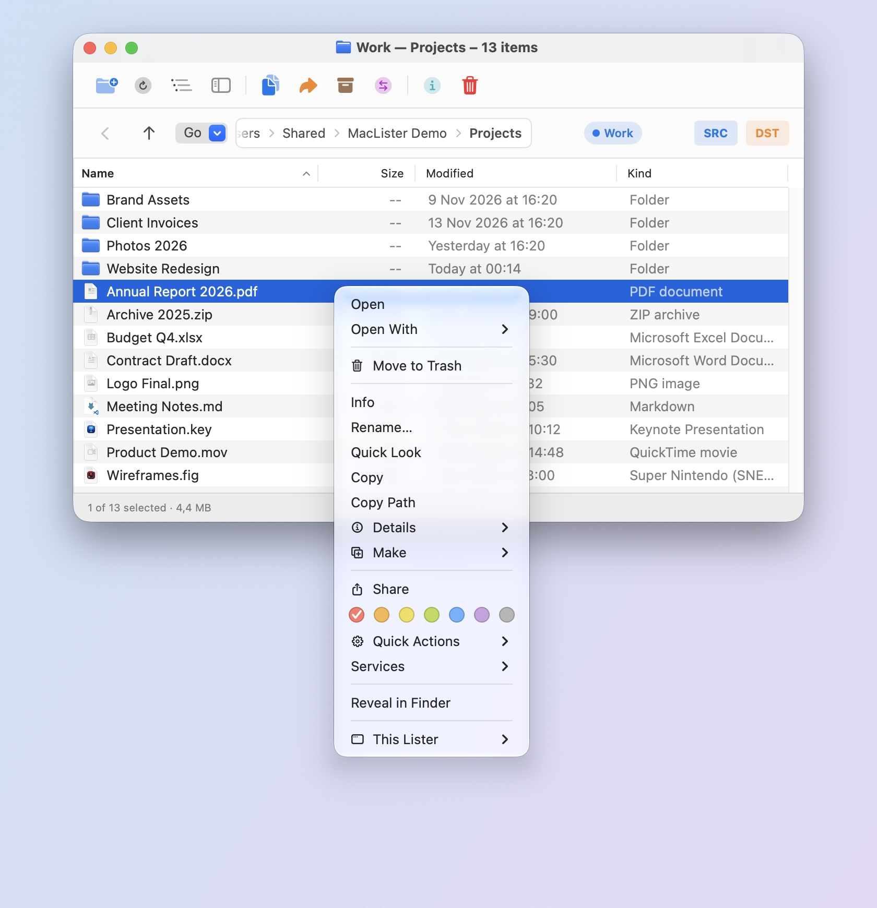
  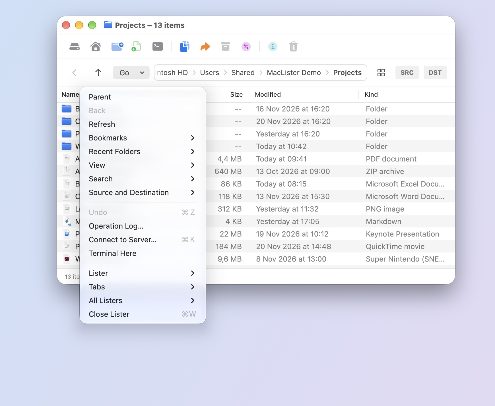
</p>

### Settings

<p align="center">
  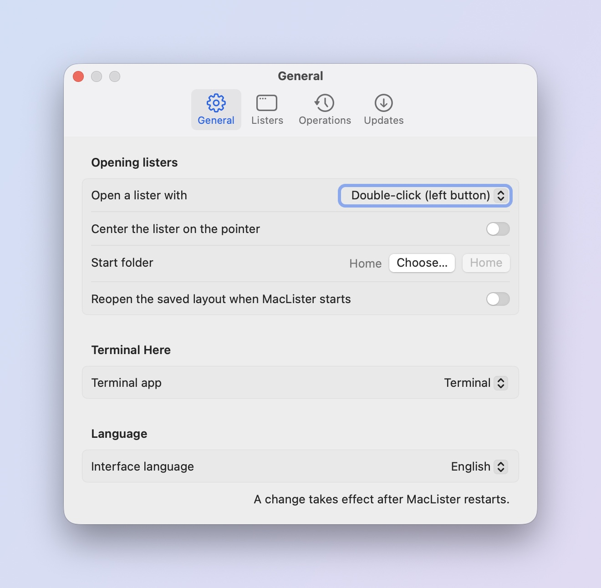
  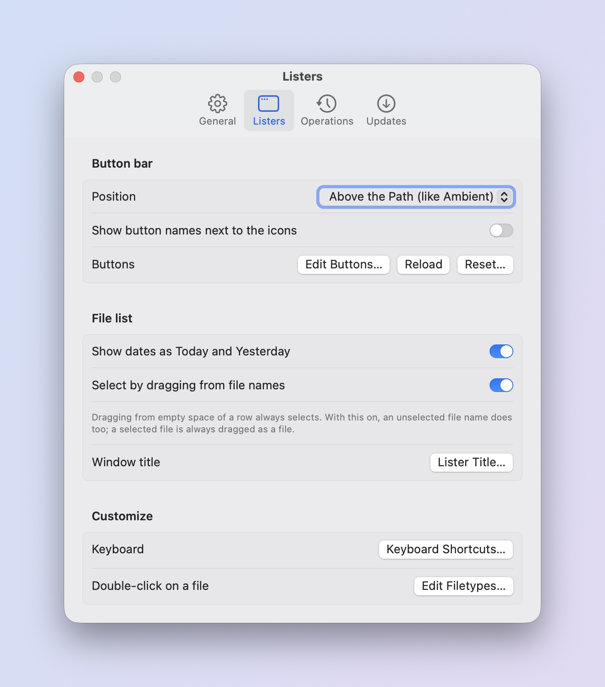
</p>

**Menu-bar icon → Settings…** (⌘,) opens a regular Mac settings window with four tabs:

- **General** — what opens a lister (double-click, middle button or both), centre it on the pointer, the folder it
  opens, reopen the saved layout at launch, listers on all desktops, the Dock icon, the terminal app for
  *Terminal Here*, the text editor for *New Text File*, the interface language.
- **Listers** — button bar position and labels, folders above files, **Edit Buttons…** / *Reload* / *Reset…*, relative dates,
  **tabs in listers**, open archives like folders, drag-select from file names, **Lister Title…**, **Keyboard Shortcuts…**, **Edit Filetypes…**.
- **Operations** — how long the operation log is kept, **Open Operation Log…**, and **Clear Recent Folders…** /
  **Clear Operation Log…** (each asks for confirmation first).
- **Updates** — version, last check, automatic checks (off by default), *Check for Updates…*.

### Dock icon and desktops

MacLister shows an icon in the **Dock** by default (**Settings → General → Show MacLister in the Dock** turns it off;
the menu-bar icon stays either way). **Right-click the Dock icon** for the open listers (click one to bring it
forward), New Lister, Duplicate Frontmost Lister, Connect to Server…, Bring All to Front, Close All Listers,
**Move All Listers to This Desktop**, Undo, Operation Log… and Settings…. Clicking the icon with no lister open opens
one; with listers open it brings them all forward. With the icon on, ⌘N (File menu) opens a lister and ⌘Tab finds
MacLister.

**Listers on a desktop of their own.** macOS lets an app move its windows only to the desktop that is in view. So:
switch to the desktop you want (a new empty one from Mission Control, say) and choose **Move All Listers to This
Desktop** — in the menu-bar menu, the Dock menu, a lister's context menu, or with a global shortcut you set in
*Keyboard Shortcuts* (it is also an action, `gatherListers`, for buttons and keys). **Settings → General → Show listers
on all desktops** makes them follow you everywhere instead. The macOS way works too: Control-click the Dock icon →
Options → Assign To → This Desktop.

### A folder as its own Dock icon

**Add to Dock…** (title-bar menu → **Lister**, or **This Lister** in the file list's menu) puts the folder the lister
shows into the Dock as an icon of its own — handy for *Downloads*, a project or a share you open all day. MacLister
asks first, then makes a small app for the folder in `~/Applications/MacLister Folders` (the folder's icon with a
MacLister badge, labelled with the lister's name) and adds it to the Dock, which restarts for a moment. Clicking the
icon opens a lister on that folder, or brings forward the one that already shows it; MacLister starts first if it is
not running. *Only Create the App* skips the Dock and shows the app in the Finder to drag wherever you like. The
command works for folders on this Mac, not for servers, archives or lists like Recents. To remove an icon, drag it
out of the Dock and delete its app. The apps talk to MacLister through the `maclister://open?path=/path/to/folder`
address, which you can also use from scripts (`open "maclister://open?path=$HOME/Downloads"`).

### Clearing the history

**Settings → Operations → History** has **Clear Recent Folders…** (the *Recent Folders* in the Go menu) and **Clear
Operation Log…**. Both ask for confirmation, and neither touches files or bookmarks. The same commands are at the
bottom of the *Recent Folders* menu (**Go** and the context menu) and in the Operation Log window.

### Selecting, filtering, sizes

- **Select by pattern** (`+`): wildcards such as `*.jpg`, `IMG_??.png`; several patterns separated by spaces;
  text without wildcards matches names containing it. `-` deselects, `*` inverts.
- **Filter** (⌘F): shows only files matching the pattern (folders always stay). An empty pattern clears it.
- **Select by Attributes** (context menu on empty space, or a button): conditions on name, kind (images, audio,
  video, documents, archives, folders, files), size (larger / smaller than) and modified date (within the last N
  days / older than N days). Every condition you set must match.
- **Sizes**: calculates the recursive size of the selected folders (or all folders) into the Size column. It shows
  progress with a Cancel button, and ends with the total and the space on disk. Also in the context menu of selected folders.
- **Find** (⇧⌘F, context menu on empty space, title-bar menu, or a button): searches the folder and everything below
  it by name (wildcards), by the **text inside the files**, kind, size and modified date. The results are a list in the
  same lister, like Recents: the *Where* column shows each folder, and Copy, Move, Delete, Info and Quick Look work on
  them; Back returns to the folder you came from. Results appear while the search runs, and the status line has
  a Cancel button. **Spotlight does the search** when the folder is on a volume it indexes, so MacLister keeps no index
  of its own and a search over the whole home folder is fast. Network volumes, volumes without an index and
  **Search the folders directly** in the window use a plain walk through the folders instead (slower, finds hidden and
  unindexed files too; text is searched in files up to 16 MB). Shows the first 5000 matches.
- **Find Duplicates…** (context menu on empty space, title-bar menu, or a button): finds files with exactly the same
  content below a folder. Files are compared by size first, then by their first 64 KB, and only the ones that still
  look alike are read completely (SHA-256), so a big folder is searched quickly; hard links to one file count once.
  The window lists the groups, the ones that waste the most space first, with a tick box on every copy and a menu to
  mark all but the oldest or the newest in each group. **Move to the Trash** works on what you ticked, never on all
  copies of a file (at least one always stays), is logged and can be undone with ⌘Z.
- **Checksums…** (*Details* in the context menu of files, a button in the *Info* window, or the `checksums` action):
  MD5, SHA-1, SHA-256 and SHA-512 of the selected files, calculated in one pass with progress and Cancel. Paste a
  checksum you were given into *Compare with* and it tells which file and which algorithm match; *Copy List* puts
  `hash  name` lines (the format `shasum -c` reads) on the pasteboard.
- **Flat View** (context menu on empty space, title-bar menu, or the `flatView` button action): lists every file below
  the folder, in all sub-folders, as one list (no folders; bundles such as `.app` stay). Sort, filter, select and copy
  as usual, *Where* shows the folder of each file. The same command (*Leave Flat View*) or Back returns to the folder.

### Renaming, attributes, links

<p align="center">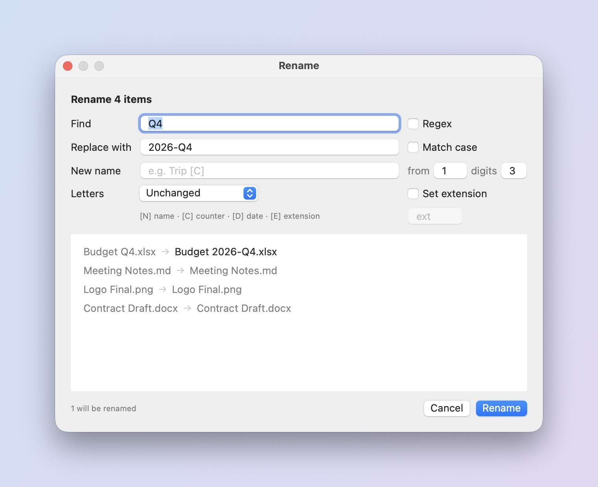</p>

- **Batch rename** (F2 with several items, or *Rename N Items…*): find and replace (plain text or regular
  expression with `$1`, `$2`, optional case matching), a name template with `[N]` name, `[C]` counter (start and
  digits), `[D]` modified date and `[E]` extension, lowercase / UPPERCASE / Title Case, and a new extension. The
  preview shows every old → new name and flags empty names, duplicates and clashes with existing files in red.
  Renaming goes through temporary names, so names can be swapped.
- **Attributes** (⌥⌘I, context menu): permissions as a read/write/execute grid (optionally for everything inside
  folders, which stay searchable), modified and created dates, hidden flag, Finder tags and comment. Only the
  groups you switch on are changed.
- **Make Alias** and **Make Symbolic Link** (context menu): created next to the originals, or in the destination
  lister's folder when there is one.
- **Open With** (context menu on files): the applications that can open the file, the default first, or *Other…*.

- **New Text File** (a default button, the context menu on empty space, or *This Lister*): makes an empty
  `untitled.txt` in the folder, selects it and opens it in **TextEdit**. **Settings → Buttons → New Text File** chooses
  another editor (Visual Studio Code, Sublime Text, BBEdit, CotEditor, Nova, Zed, TextMate, MacVim, Xcode when
  installed, or *Other App…* for any application). New installations get the button; with an older `buttons.json`
  add the `newTextFile` action in *Edit Buttons…* or use *Reset…*.

### Bookmarks and history

The **Go** menu has *Places* (Home, Desktop, Documents, Downloads, Applications, Root, mounted volumes),
*Bookmarks* (add the current folder, remove) and *Recent*. Bookmarks live in `bookmarks.json`.

<p align="center">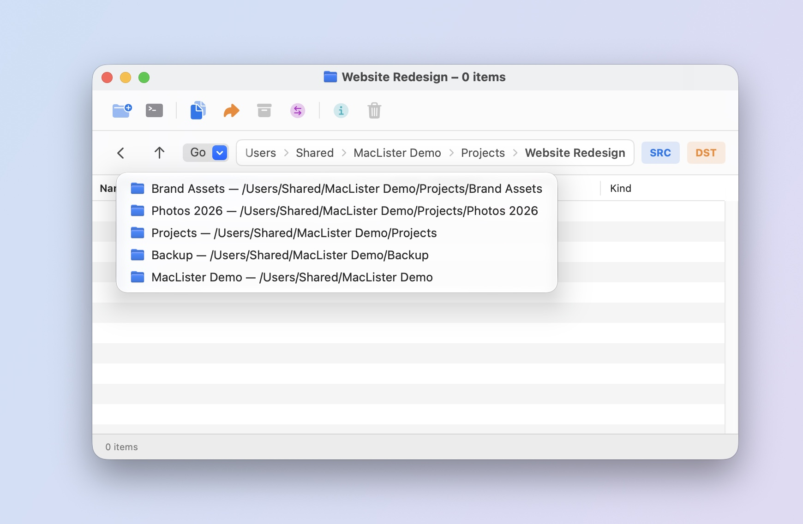</p>

**Right-click the Back button** (as in Directory Opus) for the folders this lister came from, nearest first — pick
one to jump straight there.

### Filetypes: what a double-click does, and your own context-menu entries

`filetypes.json` (**Settings → Listers → Edit Filetypes…**) maps extensions to actions: `open` (system default),
`extract`, `quicklook`, `app` (bundle identifier or path of an application), `shell` (a command, see below) and
`lister` (any button action, e.g. `"lister": "checksums"`). By default archives are **extracted** instead of opened.
The first rule that fits and has an `action` decides the **double-click**; `optionDoubleClick` (a step of its own)
is what **⌥ + double-click** does. Example:

```json
[
  { "extensions": ["zip", "tar.gz", "7z", "rar"], "action": "extract" },
  { "extensions": ["md", "txt"], "action": "app", "app": "com.apple.TextEdit", "name": "Text",
    "optionDoubleClick": { "action": "quicklook" },
    "menu": [
      { "title": "Edit in VS Code", "action": "app", "app": "com.microsoft.VSCode" },
      { "title": "Count lines", "action": "shell", "command": "wc -l {f}" },
      { "action": "separator" },
      { "title": "Checksums…", "action": "lister", "lister": "checksums" }
    ] },
  { "extensions": ["png", "jpg"], "action": "quicklook",
    "menu": [ { "title": "Make a PDF", "action": "shell", "command": "sips -s format pdf {f} --out {f-}.pdf" } ] },
  { "extensions": ["*"], "menu": [ { "title": "Copy to Desktop", "action": "shell", "command": "cp -R {F} ~/Desktop" } ] }
]
```

**`menu`** lists the entries that the **context menu** shows for files of this type, right after *Open With* (a
*title* is optional for `app`, `extract`, `quicklook` and `lister`). The entries of **every** rule that fits the
file are shown, one rule after another; `"*"` fits every file, and a rule without `action` only adds menu entries.
With several files selected an entry is shown when its rule fits all of them. More than six entries go into a
submenu named after the rule's `name`. The entries are only there for files on this Mac, not for folders or servers.

**Codes in `shell` commands**, as in Directory Opus Magellan (*Function Editor*):

| Code | Stands for |
|---|---|
| `{f}` · `{F}` | the full path of a selected file · the full paths of all of them |
| `{o}` · `{O}` | the name of a selected file · the names of all of them |
| `{df}` `{dF}` `{do}` `{dO}` | the same for the selection of the **destination** lister |
| `{d}` · `{s}` | the folder of the destination lister · of this lister |

Lower case runs the command **once for every file**, upper case **once for all of them**. Every value is put in
quotes for you (write `code {F}`, not `code "{F}"`). `-` cuts the extension (`{o-}`, `{f-}`), `!` makes a code
optional: it is empty when there is nothing to put in (`{df!}`), otherwise the command is not run and you are told
why. Anything else in braces (`{}` of `find`, `${HOME}`) is left alone. The command runs in the lister's folder;
`$LISTER_DIR` and `$LISTER_SELECTION` are set as for button commands.

**Settings → Listers → Edit Filetypes…** opens an editor for this file: the list of filetypes on the left (add, remove,
reorder), and for the chosen one its name and extensions, the **double-click** and **⌥ + double-click** (pick the
action, then the application, command or lister action it needs) and the **context-menu entries** with their titles.
A **{ }** button next to a command inserts the codes. *Open filetypes.json* in the editor opens the raw file for those
who prefer a text editor.

The file replaces the defaults; changes are picked up immediately.

### Layouts

Menu-bar icon → **Save Layout** remembers every open lister (folder, position, size, role, sort, hidden files,
filter, and which listers were tabs of one window); **Restore Layout** reopens them. To restore automatically at launch:

```bash
defaults write com.example.MacLister restoreLayoutAtLaunch -bool true
```

### Snapshot

*Snapshot This Folder* (title-bar menu, *This Lister*, or the `snapshot` action) remembers the lister's **window size
and position and the sort order** for the folder it shows. Entering that folder in any lister brings its sort order
back; a lister opened on it gets its size, and a new lister cascaded beside another one also its position. Folders
without a snapshot use the sort order you last chose by clicking a column header. *Forget Snapshot* removes it.
Snapshots are kept in `snapshots.json`.

### Browsing archives

A double-click on a zip, tar, tar.gz, 7z, rar, iso … file shows what is inside, like a folder, **without unpacking it**
(the way XAD does on the Amiga). MacLister reads the archive's list of contents with the system's libarchive, so even a
multi-gigabyte archive opens at once and every folder, size and date is there; the files themselves stay in the
archive. A file is taken out only when you use it: open it, preview it with Quick Look, copy it (or drag it out),
open it with an application, take its checksums. A progress message with Cancel shows what is being taken out; a folder
is taken out in one pass. Everything is read-only: the path bar and the title name the archive (`…/pack.zip/folder`),
*Parent* from the top of the archive goes back to the folder it lies in, and commands that would change the archive
(Trash, Rename, New Folder, Move out of it, dropping into it, Find, Synchronize …) are not offered, or say why. An archive
inside an archive opens the same way.

**Passwords.** A password-protected **ZIP** (the usual ZIP encryption and AES) lists its files at once; the first file you
use asks for the password, which is kept until MacLister quits. The system's libarchive cannot decrypt **7z and RAR**
passwords: those archives say so instead of asking.

What is taken out lives in `~/Library/Caches/MacLister/Archives` (placeholders of the right size and date, real files
once needed) and is removed when nobody opened the archive for two days. **Settings → Listers → Open archives like
folders** turns browsing off (then your filetype rule decides, and the stock rule unpacks the archive); *Extract* unpacks
into a folder either way. A filetype rule that opens an application or runs a command still wins over browsing. Formats
libarchive cannot list are unpacked completely with `bsdtar`, as before.

## Servers: FTP, FTPS and SFTP

<p align="center">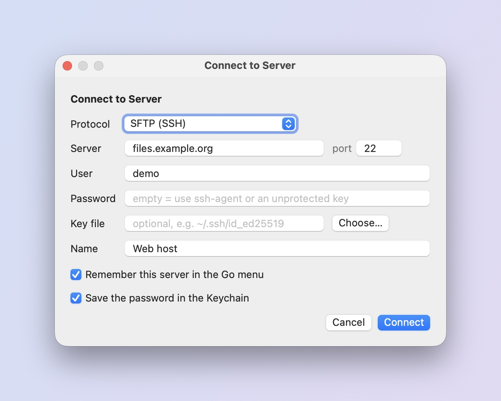</p>

A lister can show a server like a folder. **Go → Connect to Server…** (or ⌘K, or the menu-bar icon) asks for the
protocol, address, port, user and password. SFTP can use a key file (and its passphrase) or your ssh-agent.
**Remember this server** puts it in the Go menu; **Save the password in the Keychain** keeps the password out of
every file.

| Protocol | Notes |
|---|---|
| **SFTP** (SSH) | uses the system's OpenSSH `sftp` with one background connection per server, so only the first operation logs in |
| **FTPS, explicit** (`AUTH TLS`, port 21) | uses the system's `curl`; the certificate is checked |
| **FTPS, implicit** (port 990) | same, TLS from the first byte |
| **FTP** | no encryption: MacLister warns that the password travels in clear text |

- **Host keys (SFTP):** the first time a server is seen you get its fingerprints and decide whether to trust it;
  they are kept in MacLister's own `known_hosts`. If a trusted server's key ever changes, the connection is refused.
- **Certificates (FTPS):** an untrusted certificate is refused unless you tick *Accept an untrusted certificate*
  (shown with a warning).
- **Passwords** go to `curl` through a config on stdin and to `ssh` through `SSH_ASKPASS`; they never appear on a
  command line.

What works on a server: browsing (breadcrumb, columns, sort, filter, hidden files, bookmarks, history, typing a
path or a full URL), opening a file (it is downloaded to a cache first), Quick Look, **Copy and Move between a
server lister and a local lister in both directions** (source/destination listers, drag and drop onto a server),
Move inside one server, **New Folder, Rename, Delete** (servers have no Trash, so deleting asks first). Transfers have
the same progress bar, Cancel and conflict questions (Replace, Replace If Newer, Keep Both, Skip, Merge) as local ones.

**Wildcards in SFTP names:** OpenSSH's `sftp` expands `* ? [ ] { }` in file names and offers no way to switch that
off, so a file called `star*.txt` could also match `starfish.txt`. MacLister checks the folder listing first: a
download or listing that would be ambiguous is refused with an explanation, a delete is done through a temporary
plain name (so nothing else is touched), and names containing `{` or `}` are refused. Uploads from local files with
such names go through a temporary link.

Not on servers yet: attributes and Info, aliases, extracting archives, calculating folder sizes, batch rename,
dragging files *out of* a server lister, copying between two servers or inside one, resuming interrupted transfers,
automatic refresh. FTP paths are relative to the login folder. Symbolic links on a server are shown as files;
double-clicking one tries to enter it first. Opening a server file downloads it; changes are not uploaded back.

## Keyboard shortcuts you can set

<p align="center">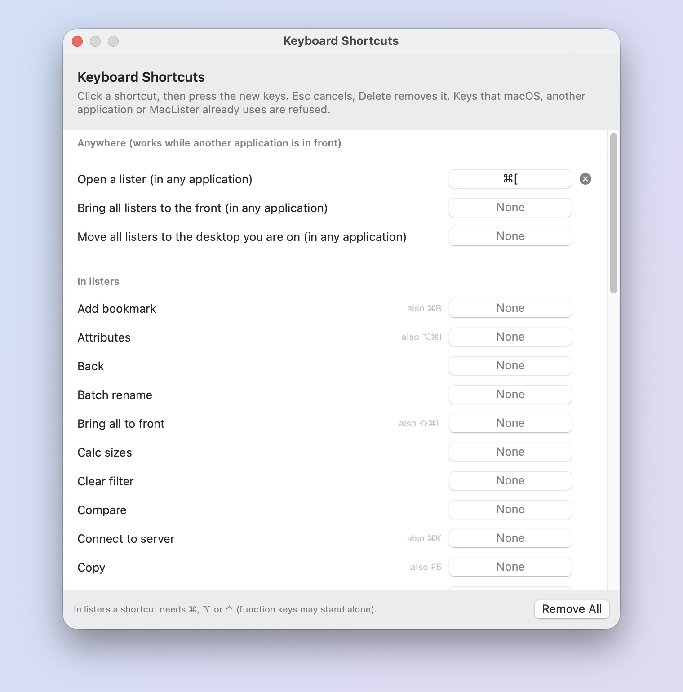</p>

**Settings → Listers → Keyboard Shortcuts…** (also in the title-bar menu). Click a shortcut and press the keys; Esc cancels,
Delete removes it.

- **Anywhere:** *Open a lister* (at the mouse pointer, in any application) and *Bring all listers to the front*.
- **In listers:** one shortcut for every action (Copy, Move, Extract, Compare, Connect to Server, Lock Role, Select by
  Pattern …), on top of the built-in keys.

Every shortcut is checked before it is accepted, and the editor explains what is wrong:

1. it needs ⌘, ⌥ or ⌃ (function keys and arrows may stand alone in listers; global shortcuts always need a modifier);
2. it must not be a macOS shortcut: MacLister reads the enabled shortcuts of System Settings → Keyboard → Keyboard
   Shortcuts (Spotlight, Mission Control, screenshots, switching Spaces …) with your own changes;
3. it must not be a key every app owns (⌘Q, ⌘W, ⌘M, ⌘H, ⌘A, ⌘C, ⌘V, ⌘X, ⌘Z, ⌘Tab) or one MacLister already uses;
4. a global shortcut must not be registered by another application (the system is asked);
5. a combination assigned to another action asks whether to move it.

Assignments are stored in `shortcuts.json`.

## Progress details

<p align="center">
  <picture>
    <source media="(prefers-color-scheme: dark)" srcset="docs/screenshots/transfer-details-dark.jpg">
    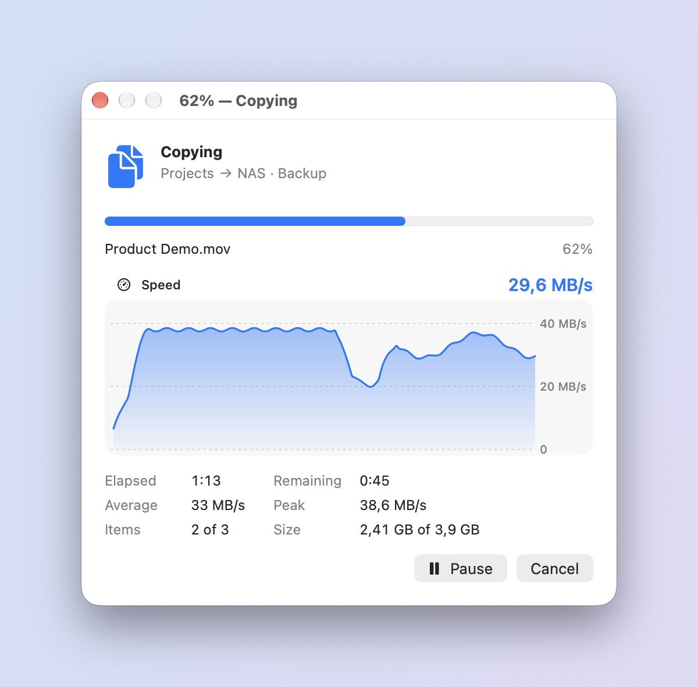
  </picture>
</p>

The progress bar in a lister's status line is clickable: it opens a window (the Mac counterpart of Directory Opus'
copy dialog) with what is being copied and where, a progress bar with the current file, a **speed graph**,
the current / average / peak speed, elapsed and remaining time, items and bytes done, and **Pause** / **Cancel**.
Pause takes effect after the file being copied (one file cannot be interrupted half way). Speed moves smoothly even
inside one big file for local copies and downloads; uploads report per file. The window title follows the job
(“37% — Copying”) and the window closes itself a moment after the job ends.

### Recents and Shared

The **Go** menu starts with **Recents** — the files you opened in the last 30 days, newest first, taken from
Spotlight (documents only: no folders, applications or `~/Library`) — and ends its places with **Shared**: mounted
network volumes, the servers you saved in MacLister and computers that offer file sharing on the local network
(SMB, AFP, SFTP, FTP). Both are lists, not folders: a *Where* column shows each file's folder, you can open, preview,
copy and drag the files, but Parent, New Folder, bookmarks and "copy into this lister" are not available. Opening
an SMB or AFP computer hands it to Finder to mount; an SFTP or FTP computer opens the *Connect to Server* form filled
in. The first visit to Shared makes macOS ask once for **Local Network** access.

### Naming listers

With many listers open it helps to tell them apart: right-click the title bar (or the empty list area) →
**Name This Lister…** and give it a name and a colour. The name appears in the window title (“NAS — Backup”), as a
coloured tag next to the path (click it to change), in the menu-bar list of listers and in *Copy to “NAS”* /
*Move to “NAS”* — so you pick the destination by name. Names are saved with *Save Layout*; a duplicate does not
inherit one. There is also an action, `nameLister`, for a button or a key.

### Queue

Copies and moves that write to the same disk (or the same server) run one after another; the later ones show
*Waiting in queue…* and a small **In queue: N** menu next to the progress bar, where each can be removed. Operations
for different disks still run side by side. Files that are being copied or moved — or wait to be — cannot be trashed,
renamed or moved from under the job; MacLister says so instead.

### Spring-loaded folders

Hold dragged files over a folder in a list, or over a closed folder in the tree, for about a second and it opens, so
you can carry the files several levels down in one drag (the pointer must rest; the delay is the hidden setting
`springLoadedDelay`, 0.8 s by default). **Settings → Listers → Open folders when you drag files over them** turns it off.

### Drag-select

<p align="center">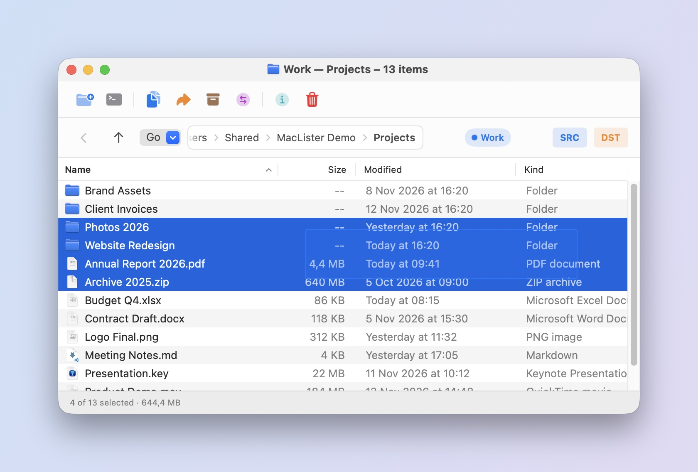</p>

Press on a row — on its empty part in the Size / Modified columns or right of a name, or below the last row — and
drag: every row between the press and the pointer is selected, as in Directory Opus (⌘ or ⇧ adds to the selection;
the list scrolls when you reach the edge). By default this also works from an **unselected file name**; a press
anywhere on a *selected* row (name or blank part) drags the selected files, so you can still drag files out. Prefer the Finder behaviour (a name press always
drags the file)? **Settings → Listers → Select by dragging from file names** off.

### Tab between listers

**Tab** moves the keyboard to the next lister (in the order they were opened), **⇧Tab** to the previous one. Both are
also actions (`nextLister`, `previousLister`) you can give another key or a button.

### Tabs

<p align="center">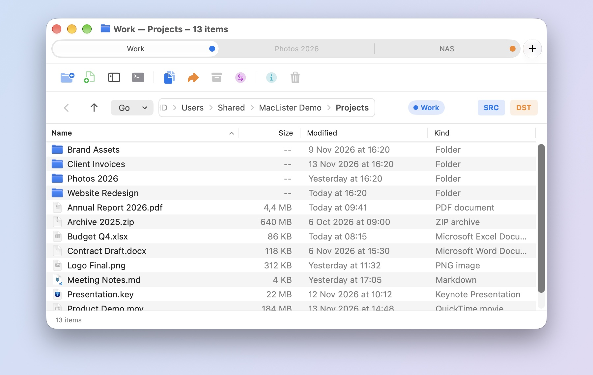</p>

A lister window can hold several folders as tabs, like Finder or a web browser (**Settings → Tabs → Allow tabs in
listers**, on by default; new listers still open as windows of their own). Each tab is a full lister of its own
(history, sort, filter, selection, folder tree), so everything else works per tab.

- **⌘T** (or the **+** at the end of the tab bar) opens the folder you are in in a new tab; **⌘ + double-click** on a
  folder, or **Open in New Tab** in its context menu, opens that folder in one. The tab bar appears once a window has
  two tabs; drag tabs to reorder them, out of the window to make a lister of their own, or onto another window.
- **⌃Tab / ⌃⇧Tab** (or ⇧⌘] / ⇧⌘[) go to the next / previous tab, **⌘W** closes a tab. **Tab** still goes between
  lister windows and skips the tabs you cannot see.
- **Names.** A tab shows the name of its folder and follows it as you navigate. Right-click a tab (or the title bar)
  → **Tabs → Name This Tab…**, or just **double-click the tab**, to give it a name of its own and a colour (a dot in the
  tab); the name stays when the tab
  goes to another folder. *Use the Folder's Name* returns to the default. This is the same name as
  [Name This Lister…](#naming-listers), so it also shows in the title and in *Copy to “…”*.
  The double-click is a setting: **Settings → Tabs → Double-click on a tab** can also open a new tab on the
  same folder, close the tab, or do nothing.
- **Source and destination belong to the window.** Only the tab you see can be the source or the destination: when you
  switch tabs, the role (and its lock) goes along to the tab you switch to, so a copy never lands in a folder you
  cannot see. Closing that tab leaves the role with the tab shown next. Merging windows that both had a role keeps the
  role of the tab you see.
- The title-bar menu has a **Tabs** submenu: New Tab, Name / Rename This Tab…, Next / Previous Tab, **Move Tab to New
  Lister**, **Merge All Listers into Tabs**, Close Other Tabs. The menu-bar list of listers shows the tabs of a window
  together, the later ones indented.
- Actions for buttons and keys: `newTab`, `nextTab`, `previousTab`, `moveTabToNewLister`, `mergeListers`.
- Turning the setting off makes every tab a lister window of its own again. New listers (desktop double-click, *New
  Lister*) always open as windows, also with macOS's *Prefer tabs when opening documents* set to *Always*.

### Undo and the operation log

<p align="center">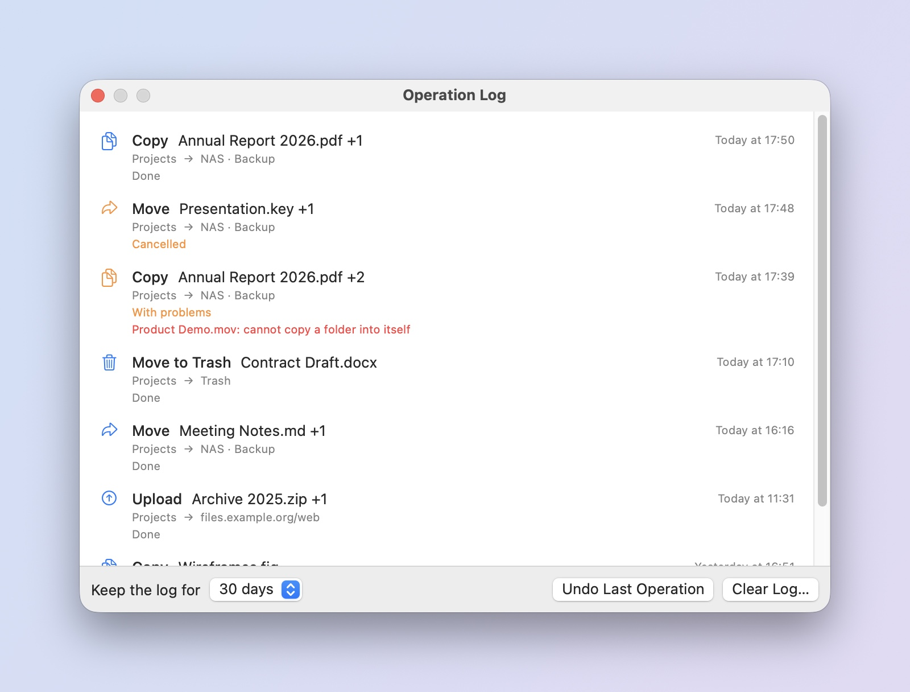</p>

**⌘Z** (or *Undo…* in the context menu and the menu-bar menu) takes back the last **copy, move, duplicate or Move to
Trash** done on your disk during this session, one operation at a time, newest first:

- a copy or duplicate: the new items go to the Trash;
- a move or trashing: the items go back where they came from (never over something that is there now);
- *Replace* in a conflict: the file that was replaced comes back from the Trash;
- a folder merge, and anything on a server, is logged but not undone.

Nothing is ever deleted for good by Undo. **Operation Log…** (context menu or menu-bar menu) lists every copy,
move, upload, download, duplicate and trashing with its outcome, newest first. The log is kept in
`operations.json`; **Keep the log for 7 / 30 / 90 days or a year** (default 30) and at most 1000 entries, so it
never grows without limit. Undo itself is available only for the current session.

### Button clicks and the button editor

<p align="center">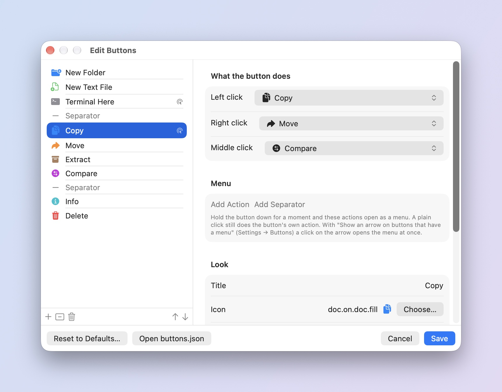</p>

As in Directory Opus 5, every button can do a different thing for the **left, right and middle mouse button**. Menu-bar
icon → **Edit Buttons…**: pick a button, choose the action for each mouse button (or a shell command), reorder,
add, remove, change the icon, color and tooltip, **Save**. Buttons that have extra clicks show a small marker in the
editor and list them in their tooltip. The action is chosen in a popover with a search field, grouped and sorted by
name. The icon is an **SF Symbol** (one of the icons that come with macOS; pick one from the grid or type any name) or
**your own picture**: *Choose Image…* takes a PNG, JPEG, PDF or icns, copies it (scaled to at most 128 points) into
`~/Library/Application Support/MacLister/ButtonIcons` and shows it as it is, without the colour; `iconFile` in
`buttons.json` holds its name. In `buttons.json` the keys are `rightAction` / `rightCommand` and
`middleAction` / `middleCommand`. *Open buttons.json* in the editor opens the raw file for text-editor people.

### Lister title format

<p align="center">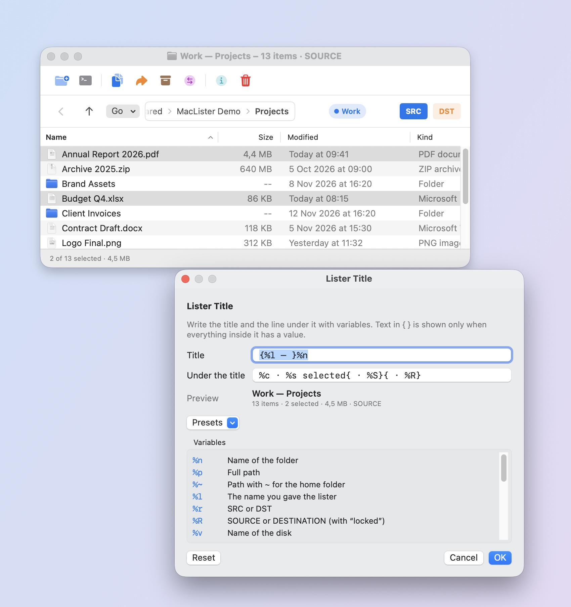</p>

**Settings → Listers → Lister Title…** (or the lister's context menu) sets what the window title and the line under it say.
Write text with variables; **`{ … }` is shown only when everything inside it has a value**, so `{%l — }%n` is
“Work — Reports” for a named lister and just “Reports” for the others. The editor has a live preview, presets and
the list of variables:

| | | | |
|---|---|---|---|
| `%n` folder name | `%p` full path | `%~` path with ~ | `%l` lister name |
| `%r` SRC / DST | `%R` SOURCE / DESTINATION | `%v` disk name | `%h` server |
| `%c` “11 items” | `%d` folders | `%f` files | `%s` selected count |
| `%S` selection size | `%F` free space summary | `%b` free | `%B` disk size |
| `%m` filter | `%t` time | `%D` date | `%%` `%{` `%}` literals |

Defaults: title `{%l — }%n{ – %h}`, subtitle `%c{ · %F}{ · %R}`.

### Updates

Menu-bar icon → **Check for Updates…** (or **Settings → Updates**) asks GitHub whether a newer release exists and shows its notes (with the notes of any versions you skipped in between); **Install and
Restart** downloads it, checks the SHA-256 against the release's `.sha256` file and the code signature, then
replaces the app and starts it (needs a writable install folder; otherwise it opens the release page).
**Settings → Updates → Check for updates automatically** looks once a day — it is **off by default**, MacLister asks you once after
starting whether you want it. Nothing is installed without your click, and the request carries no information
about you. **Skip This Version** silences one release. The address is in `Info.plist` (`MacListerUpdateFeed`);
`defaults write com.example.MacLister updateFeedURL <url>` overrides it.

## Dates

The *Modified* and *Created* columns can show dates the way Finder does — *Today, 10:05*, *Yesterday …*
(in Polish also *przedwczoraj*), older dates in full. Right-click the column header → **Relative Dates**
(on by default; the raw form is one click away).

## Language

MacLister follows the macOS language: Polish on a Polish system, English otherwise. To choose, use **Settings → General → Interface
language** (*System Default / English / Polski*); the app offers to restart. Counted texts use proper Polish plurals
(1 element, 2 elementy, 5 elementów). `python3 Tools/check_localization.py` verifies that every text in the sources has a
Polish translation (`Support/pl.lproj`).

## Progress in the menu bar

While anything copies, moves, downloads or deletes, the menu-bar icon turns into a progress ring with a percentage
(several jobs: their average) and its tooltip says what is running.

## Configuration

Files in `~/Library/Application Support/MacLister/`:

| File | Purpose |
|---|---|
| `buttons.json` | bottom button bar |
| `filetypes.json` | double-click actions |
| `bookmarks.json` | bookmarked folders |
| `layout.json` | saved layout |
| `shortcuts.json` | your keyboard shortcuts |
| `servers.json` | saved servers (without passwords; those are in the Keychain) |
| `known_hosts` | SFTP host keys you trusted |

### Buttons

**Settings → Listers → Edit Buttons…** opens the button editor (see *Button clicks and the button editor*); after changing
`buttons.json` by hand use **Reload** next to it (all open listers update). **Reset…** rewrites the file (use it after an update to get new default buttons; also
`MacLister --reset-buttons`). The default set is short: New Folder, New Text File, Terminal Here, Copy, Move, Extract,
Compare, Info, Delete. Everything else (select, filter, sizes, duplicate lister, swap …) is in the menus and
shortcuts, or add it as a button.

```json
[
  { "title": "New Folder", "symbol": "folder.badge.plus", "action": "newFolder" },
  { "title": "Copy", "symbol": "doc.on.doc", "action": "copy", "help": "Copy to destination (F5)" },
  { "title": "Code", "symbol": "chevron.left.forwardslash.chevron.right",
    "action": "shell", "command": "open -a 'Visual Studio Code' \"$LISTER_DIR\"" }
]
```

Each button can also have `rightAction`, `rightCommand`, `middleAction`, `middleCommand` (see *Button clicks*).
`symbol` is an SF Symbols name (optional), `color` tints the icon (`blue green orange red purple teal pink yellow
brown gray`; default neutral), `help` the tooltip, `requiresSelection` (true/false) overrides when a button is
enabled. `{ "title": "", "action": "separator" }` draws a thin divider between groups. **Actions:** `newFolder terminalHere delete parent back refresh revealInFinder open newLister
toggleHidden copy move setSource setDestination swapSourceDestination extract bringAllToFront duplicateLister
duplicateFile selectPattern deselectPattern selectAll selectNone invertSelection filter clearFilter calcSizes
compare info showInDestination destinationHere addBookmark makeAlias makeSymlink selectByAttributes toggleRoleLock batchRename attributes nameLister showRecents showShared undo showLog nextLister previousLister separator shell`.
`shell` runs `command` with `/bin/zsh` in the current folder; `$LISTER_DIR` is that folder and
`$LISTER_SELECTION` the selected paths, one per line.

### Hidden settings

Set with `defaults write com.example.MacLister <key> <value>`:

| Key | Default | Meaning |
|---|---|---|
| `centerOnCursor` | false | centre new listers on the click instead of anchoring the corner |
| `showStatusItem` | true | show the menu-bar icon (if you hide it, quit via Activity Monitor) |
| `showDockIcon` | true | the Dock icon (also: Settings → General) |
| `listersOnAllDesktops` | false | show listers on every desktop (also: Settings → General) |
| `startDirectory` | `~` | folder a desktop double-click opens |
| `terminalBundleID` | `com.apple.Terminal` | terminal used by *Terminal Here* (also: Settings → Buttons) |
| `restoreLayoutAtLaunch` | false | reopen the saved layout at start |
| `autoAssignRoles` | true | the first lister is the source, the next the destination (also: Settings → General) |
| `desktopTrigger` | `doubleClick` | `doubleClick`, `middleClick` or `both` (also: Settings → General) |
| `buttonBarPosition` | `abovePath` | `abovePath`, `belowPath` or `bottom` (also: Settings → Listers) |
| `showButtonLabels` | false | text next to the button icons |
| `buttonMenuDirection` | `automatic` | where a button's menu opens: `automatic` (above when the bar is at the bottom), `below`, `above` (also: Settings → Buttons) |
| `relativeDates` | true | *Today / Yesterday* in the date columns (also: column header menu) |
| `springLoadedFolders` | true | open a folder that dragged files rest on (also: Settings → Listers) |
| `springLoadedDelay` | 0.8 | seconds the files must rest on the folder first (0.2 to 5) |
| `debugHitTest` | false | log every click decision to `~/Library/Logs/MacLister.log` |

## Troubleshooting

- **Nothing happens on a double-click.** Open the menu-bar icon: if it says *Waiting for Accessibility
  permission…*, grant both permissions (step 4) and restart the app. If permissions look right but are
  ignored (for example after reinstalling), reset them and grant again:

  ```bash
  tccutil reset All com.example.MacLister
  ```

- **A lister opens on an icon, or not on empty space.** Turn on `debugHitTest` and look at
  `~/Library/Logs/MacLister.log` – each double-click logs what was under the cursor.
- **Windows slide away and the lister is half off-screen.** Disable *Click wallpaper to reveal desktop*
  (install step 6).
- **"Terminal Here" opens the wrong app.** Settings → General → *Terminal app*.
- **New buttons are missing after an update.** Settings → Listers → Buttons → *Reset…*.
- **Gatekeeper says the app is damaged or cannot be opened.** Install step 3 (`xattr -dr com.apple.quarantine`).

## Build from source

Requires Xcode or the Command Line Tools (Swift 5.9+).

```bash
./build.sh                       # build/MacLister.app for this Mac
./build.sh release --universal   # arm64 + x86_64
./package.sh                     # universal build zipped to dist/ with a SHA-256 file
```

Built-in self-tests drive real listers through roles, copy/move, extraction, menus, filters and more, and write
PASS/FAIL lines to `~/Library/Logs/MacLister.log`:

```bash
open build/MacLister.app --args --selftest
open build/MacLister.app --args --selftest-features
open build/MacLister.app --args --selftest-tabs
```

Add `--quiet` to run a test while you keep working: MacLister then never takes the keyboard and its windows are
invisible and let clicks through (they are still real windows). Start the binary itself, so the arguments reach it
even while another MacLister runs: `build/MacLister.app/Contents/MacOS/MacLister --selftest-features --quiet`.

Server tests run against small local FTP/FTPS servers (standard-library Python in `Tools/mock_ftp_server.py`):
start it with `--port`, `--root` and optionally `--tls explicit|implicit --cert … --key …`, then
`open build/MacLister.app --args --selftest-remote ftp=2121 ftpes=2122 ftps=2123 root=<the served folder>`.

SFTP is tested two ways: `sftpdir=<folder>` runs the `sftp` commands against the system's local `sftp-server`
(no network), and `sftp=<port> sshuser=… key=… pkey=… "pass=…" sshdir=…` against a throw-away `sshd` you start on
`127.0.0.1` with its own keys (host key trust, key files, passphrases through `SSH_ASKPASS`, changed host keys).

`MacLister --open [folder]` opens a lister at launch.

The app icon is drawn in code: `swift Tools/make_icon.swift` regenerates `Support/AppIcon.icns` (two overlapping
lister windows, source blue and destination orange, with Amiga-style gadgets on a macOS rounded square).

Layout: `Sources/MacLister/` – `DesktopDoubleClickMonitor` (event tap), `DesktopHitTest` (is this empty desktop?),
`ListerWindowController` / `ListerManager` (windows, roles, layouts), `ListerViewController` (+ `Features`)
(file table and actions), `Bars` (SwiftUI path and button bars), `FileTransfer`, `ArchiveExtractor`, `Stores`
(bookmarks, history, filetypes, layouts).

## Privacy and security

- To spot double-clicks MacLister reads mouse-button events system-wide through a **listen-only** event tap: it
  cannot change or block your input, and it ignores keystrokes. macOS files this under *Input Monitoring*.
- Accessibility is used to ask what element is under the cursor; nothing else.
- No network access, no telemetry. The only log is `~/Library/Logs/MacLister.log` (start-up status; clicks only
  with `debugHitTest`).
- The app is **not sandboxed** (it must browse arbitrary folders), ad-hoc signed and **not notarized**. It
  therefore cannot be distributed through the Mac App Store.
- Folders such as Desktop, Documents and Downloads trigger the usual macOS file-access prompts.

## Known limitations

No hex viewer, no search, duplicates, checksums or snapshots on servers, and archives are browsed read-only (they cannot be changed from inside).
Servers support browsing, copying and the basic folder operations only (see *Servers*).
Dragging uses Finder conventions. 7z and RAR passwords are not supported (the system library cannot decrypt them).

## License

MacLister is released under the [MIT License](LICENSE).
