# MacLister

Menedżer plików oparty na listerach dla macOS, w duchu **Directory Opus Magellan**: dwuklik w puste miejsce
pulpitu otwiera lister dokładnie tam, gdzie kliknąłeś. Natywna aplikacja w Swift (AppKit + SwiftUI),
działa w pasku menu, z opcjonalną ikoną w Docku.

**Strona:** [maclister.github.io](https://maclister.github.io/) · **Język:** [English](README.md) · Polski

<p align="center">
  <picture>
    <source media="(prefers-color-scheme: dark)" srcset="docs/screenshots/lister-pair-dark.jpg">
    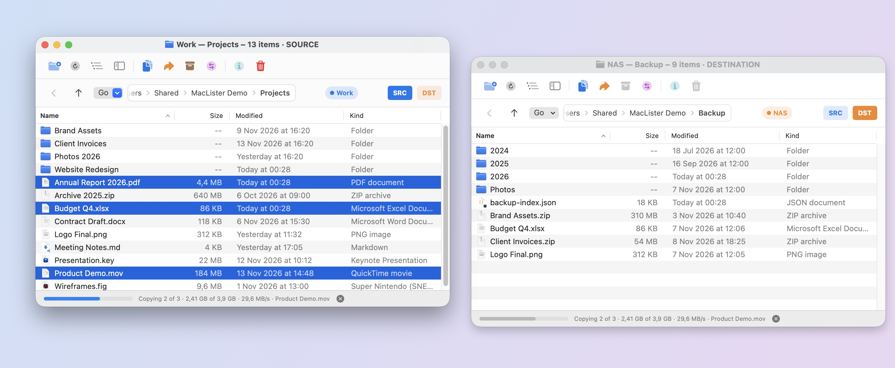
  </picture>
</p>
<p align="center"><sub>Listery źródłowy i docelowy z nazwami, kolorami i trwającym kopiowaniem. Wszystkie pliki na obrazkach są zmyślone.</sub></p>

## Najważniejsze cechy

- **Dwuklik na pulpicie otwiera lister** pod kursorem. Dowolna liczba listerów naraz.
- **Listery źródłowy i docelowy**: Copy (F5), Move (F6), Extract, Compare, Swap.
- **Przeciąganie i upuszczanie** między listerami oraz z/do Findera (reguły Findera: ten sam wolumin przenosi,
  ⌥ kopiuje, ⌘ przenosi).
- **Konfigurowalny pasek przycisków**, **akcje dla typów plików** (co robi dwuklik), **zakładki**, **zapisane układy**.
- Zaznaczanie wzorcem, filtr, **wyszukiwanie** (Spotlight albo przejście po folderach), **duplikaty**, **sumy kontrolne**, rozmiary folderów, panel informacji, zmiana nazwy, duplikowanie, Quick Look na
  Spacji, rozpakowywanie archiwów (zip, tar.\*, 7z, rar, gz, bz2 …) i **przeglądanie archiwów jak folderów**.
- **Prawy przycisk na belce okna** otwiera polecenia listera (duplikuj, źródło/cel, zamknij wszystkie …).
- **Cofnij** ostatnie kopiowanie, przeniesienie, duplikowanie lub wyrzucenie do Kosza (⌘Z) oraz **dziennik operacji**
  z limitem przechowywania.
- **Zaznaczanie przeciąganiem** (naciśnij wiersz i ciągnij w dół lub w górę, żeby zaznaczyć wiersze pomiędzy), **Tab** między
  listerami, **menu historii** pod prawym przyciskiem na przycisku Wstecz.
- **Lewy, prawy i środkowy przycisk** każdego przycisku mogą robić co innego; **edytor przycisków** i **format tytułu**
  ze zmiennymi `%`.
- **Sprawdzanie aktualizacji** — ręczne albo automatyczne, jeśli się zgodzisz (domyślnie wyłączone).

## Wymagania

macOS 13 Ventura lub nowszy. Apple Silicon albo Intel (wersja uniwersalna; część dla Intela nie była
uruchamiana na prawdziwym sprzęcie Intel).

## Instalacja

1. Pobierz `MacLister-<wersja>-macos.zip` ze strony **Releases** tego repozytorium. Opcjonalnie sprawdź sumę:
   `shasum -a 256 -c MacLister-<wersja>-macos.zip.sha256`.
2. Rozpakuj i przeciągnij **MacLister.app** do `/Applications`.
3. **Pierwsze uruchomienie.** Aplikacja jest podpisana ad-hoc i nie przeszła notaryzacji Apple (płatnego programu dla programistów), więc Gatekeeper z początku ją
   blokuje:
   - kliknij aplikację z klawiszem Control → **Otwórz** → **Otwórz**, albo
   - Ustawienia systemowe → Prywatność i ochrona → **Otwórz mimo to** (macOS 15 i nowsze), albo
   - raz wykonaj `xattr -dr com.apple.quarantine /Applications/MacLister.app`.
4. **Nadaj dwa uprawnienia** w Ustawieniach systemowych → Prywatność i ochrona:
   - **Dostępność** – żeby rozpoznać, co jest pod kursorem (puste miejsce, ikona, okno, Dock).
   - **Monitorowanie wprowadzania** – macOS wymaga go dla pasywnego nasłuchu, który widzi dwuklik.

   Włącz oba dla MacLister, potem **zamknij i uruchom aplikację ponownie** (ikona w pasku menu → *Quit MacLister*).
5. Kliknij ikonę w pasku menu. Pierwsza linia powinna brzmieć **Desktop double-click: active**.
6. *Zalecane:* wyłącz systemowe odsłanianie pulpitu. Inaczej pierwszy klik dwukliku odsuwa wszystkie okna
   na bok, a nowy lister może wylądować częściowo poza ekranem.
   Ustawienia systemowe → Pulpit i Dock → **Kliknij tapetę, aby odsłonić pulpit** → *Tylko w Stage Manager*, albo:

   ```bash
   defaults write com.apple.WindowManager EnableStandardClickToShowDesktop -bool false
   ```

7. *Opcjonalnie:* uruchamianie przy logowaniu: Ustawienia systemowe → Ogólne → Elementy logowania → **+** → MacLister.

**Odinstalowanie:** zamknij aplikację z ikony w pasku menu, usuń ją, usuń `~/Library/Application Support/MacLister`,
wykonaj `defaults delete com.example.MacLister` i usuń MacLister z dwóch list uprawnień.

## Użycie

### Otwieranie listera

- **Dwuklik w puste miejsce pulpitu.** Na ikonach, oknach, pasku menu i Docku nic się nie dzieje, a kliknięcia
  z wciśniętym ⌘/⇧/⌥/⌃ są ignorowane. Wolisz rolkę myszy? **Ustawienia → Ogólne → Otwieraj lister przez** pozwala
  otwierać lister **pojedynczym kliknięciem środkowego przycisku** zamiast dwukliku albo oprócz niego.
- Albo ikona w pasku menu → **New Lister**.
- Domyślnie lewy górny róg okna leży w punkcie kliknięcia; **Ustawienia → Ogólne → Wyśrodkuj lister na kursorze**
  wyśrodkowuje okno. Lister otwiera się w folderze domowym (zob. *startDirectory* niżej).

### Budowa listera

- **Pasek ścieżki:** *Back*, *Parent*, menu **Go** (miejsca, woluminy, zakładki, ostatnie foldery), ścieżka jako
  klikalny **breadcrumb** (kliknij folder, żeby tam przejść; kliknij puste miejsce paska albo naciśnij **⌘L**, żeby
  wpisać ścieżkę, `~` działa) oraz znaczki **SRC** / **DST**.
- **Lista plików:** ikona, nazwa, rozmiar, data modyfikacji. Kliknięcie nagłówka sortuje; foldery domyślnie są
  na początku (wyłączysz to w **Ustawienia → Listery → Foldery nad plikami przy sortowaniu** albo w menu nagłówka kolumn). Dwuklik lub Return otwiera plik albo wchodzi do folderu. **Prawy przycisk na nagłówku kolumn**
  wybiera kolumny: Size, Modified, Created, Kind, Extension, Permissions, Tags, Comment. Przeciągnięte szerokości kolumn są zapamiętywane
  (Name zawsze zajmuje pozostałe miejsce).
- **Lista odświeża się sama**, gdy pliki są dodawane, usuwane lub zmieniane na dysku (FSEvents), a podtytuł okna
  pokazuje wolne miejsce na woluminie.
- **Pasek przycisków** nad paskiem ścieżki, jak w Ambiencie na MorphOS (zob. *Konfiguracja*): same ikony, nazwa
  w podpowiedzi. **Ustawienia → Listery → Pasek przycisków** ustawia go nad ścieżką, pod ścieżką albo na dole;
  **Show Button Labels** dodaje napisy.
- Cienka **linia stanu** na dole: liczba elementów, rozmiar zaznaczenia, filtr, postęp i błędy.
- Nowe listery mają 560 × 400 i pamiętają rozmiar, który ostatnio nadałeś listerowi przeciągając krawędź.
- Opcjonalny **pasek boczny i drzewo folderów** po lewej (⌥⌘T albo *Pokaż drzewo folderów* w menu). Jest w nim to, co w pasku bocznym Findera, odczytane z samego Findera, więc oba zawsze się zgadzają: *Ostatnie*, *Udostępniane*, *Ulubione*, *Miejsca* (iCloud Drive, folder domowy, dyski, AirDrop, Kosz) i *Tagi* (kliknięcie pokazuje pliki z danym tagiem; *Wszystkie tagi…* wymienia pozostałe). Pod nimi jest drzewo: folder domowy i wszystkie woluminy, tylko foldery. Wybranie folderu pokazuje go w listerze, drzewo podąża za listerem, nowe foldery pojawiają się w nim, a pliki upuszczone na folder są kopiowane lub przenoszone tak jak przy każdym innym upuszczeniu. Szerokość, na którą przeciągniesz podział, jest zapamiętywana.
- Podtytuł okna pokazuje liczbę elementów i rolę listera (SOURCE / DESTINATION).

### Źródło i cel

Oznacz jeden lister jako **SRC**, a drugi jako **DST** znaczkami w pasku ścieżki (ponowne kliknięcie zdejmuje rolę).
Potem:

| Akcja | Co robi |
|---|---|
| **Copy** (F5) | kopiuje zaznaczenie listera źródłowego do folderu listera docelowego |
| **Move** (F6) | przenosi je tam |
| **Copy As** (⇧F5) / **Move As** (⇧F6) | to samo, ale najpierw pyta o nową nazwę każdego elementu, więc kopiowanie lub przenoszenie i zmiana nazwy to jeden krok; bez listera docelowego kopia trafia do tego folderu |
| **Extract** (⌘E) | rozpakowuje zaznaczone archiwa do nowego podfolderu folderu docelowego |
| **Compare** | zaznacza w obu listerach elementy, których brakuje po drugiej stronie albo które się różnią (rozmiar / nowsze) |
| **Synchronize…** | porównuje oba foldery razem ze wszystkim pod nimi i pokazuje listę tego, co zostanie skopiowane (albo trafi do Kosza); zaznaczasz, co wykonać |
| **Swap** | zamienia role miejscami |
| **Open in New Lister** | menu kontekstowe albo **Shift + dwuklik** na folderze: otwiera go w nowym listerze obok bieżącego |
| **Open in Destination** | menu kontekstowe: pokazuje zaznaczony folder w liście docelowym |

Gdy żaden lister nie jest oznaczony jako SRC, źródłem jest ten, w którym wciśnięto przycisk.

**Postęp i Cancel.** Copy i Move pokazują w linii stanu pasek postępu (element, bajty, bieżący plik) z przyciskiem
**Cancel**; foldery są przetwarzane plik po pliku, więc anulowanie działa między plikami. Przeniesienie w obrębie
tego samego woluminu to zwykła zmiana nazwy.

**Konflikty** są rozstrzygane pojedynczo, z rozmiarem i datą starego i nowego elementu: **Replace** (stary trafia
do Kosza), **Replace If Newer**, **Keep Both** („nazwa 2.ext”), **Skip**, **Cancel**, a przy folderze na folder
także **Merge** (zawartość jest wtedy rozstrzygana element po elemencie). Zaznacz **Apply to all remaining
conflicts**, żeby nie być pytanym dalej.

**Synchronize** działa na folderach listera źródłowego i docelowego (oba lokalne). *Zaktualizuj cel na podstawie źródła*
kopiuje nowe pliki i te, które są nowsze w źródle (opcja zastępuje też pliki nowsze w celu, inna przenosi do Kosza pliki
istniejące tylko w celu); *W obie strony* pozwala wygrać nowszemu plikowi w każdym kierunku i kopiuje pliki
jednostronne na drugą stronę. Nic się nie dzieje przed naciśnięciem **Synchronize**: lista pokazuje każdy planowany krok
z polem wyboru. Zastępowany plik trafia najpierw do Kosza, kopie zachowują daty (więc następne porównanie jest czyste),
a operacja jest w dzienniku i można ją cofnąć ⌘Z (pliki przeniesione do Kosza opcją *tylko w celu* nie są częścią
Cofania; wyjmij je z Kosza). Puste foldery nie są kopiowane.

**Lock Role** (menu na belce okna) przypina lister jako źródło albo cel: inny lister nie może przejąć roli, a jej
nie da się wyczyścić ani zamienić, dopóki nie odblokujesz.

### Klawiatura

| Klawisz | Akcja |
|---|---|
| Spacja | Quick Look (strzałki przechodzą po plikach, Spacja zamyka) |
| Return, ⌘↓ | otwórz plik / wejdź do folderu |
| Backspace, ⌘↑ | folder nadrzędny |
| ⌘⌫ | przenieś zaznaczenie do Kosza |
| F2 | zmień nazwę (przy kilku zaznaczonych: zmiana wielu nazw) |
| F5 / F6 | kopiuj / przenieś do listera docelowego |
| ⌘E | rozpakuj archiwa |
| ⌘I | informacje (rozmiar, daty, uprawnienia, właściciel) |
| ⌥⌘I | edycja atrybutów (uprawnienia, daty, ukryty, tagi, komentarz) |
| ⌘L | wpisz ścieżkę zamiast klikać breadcrumb |
| ⌘D | duplikuj zaznaczone pliki (`nazwa copy.ext`) |
| ⌥⌘D | **duplikuj ten lister** (ten sam folder, rozmiar, sortowanie, filtr) |
| ⌘F | filtr wzorcem |
| `+` / `-` / `*` | zaznacz wzorcem / odznacz wzorcem / odwróć zaznaczenie |
| ⌘A | zaznacz wszystko |
| ⌘B | dodaj bieżący folder do zakładek |
| ⌘⇧. | pokaż lub ukryj pliki ukryte |
| ⌘⇧L | wynieś wszystkie listery na wierzch |
| ⌘W | zamknij lister (z kartami: kartę) |
| ⌘T | nowa karta z tym folderem (gdy karty są włączone, zob. [Karty](#karty)) |
| ⌃Tab / ⌃⇧Tab, ⇧⌘] / ⇧⌘[ | następna / poprzednia karta |
| ⌘Z | cofnij ostatnie kopiowanie, przeniesienie, duplikowanie lub wyrzucenie do Kosza (w tej sesji) |
| Tab / ⇧Tab | przejdź do następnego / poprzedniego listera |

W wielu laptopach klawisze F wymagają **fn**.

### Menu

- **Prawy przycisk na liście plików** – układ jak w menu Findera; rzadziej używane polecenia są w podmenu, więc menu
  pozostaje krótkie. Na wierzchu: *Otwórz*, *Otwórz w aplikacji*, *Rozpakuj*, Kopiuj/Przenieś do listera docelowego,
  **Przenieś do Kosza** (z ikoną), *Informacje*, *Zmień nazwę*, *Szybki podgląd*, *Kopiuj* (pliki trafiają do schowka),
  *Kopiuj ścieżkę*, potem podmenu **Szczegóły** (*Atrybuty…*, *Sumy kontrolne…*, *Oblicz rozmiar folderu*, *Tagi…*) i
  **Utwórz** (**Kompresuj** – `nazwa.zip`, a dla kilku elementów `Archive.zip` –, *Powiel*, *Utwórz alias*, *Utwórz
  dowiązanie symboliczne*, *Kopiuj jako…*, *Przenieś jako…*), a dalej **Udostępnij** (systemowe menu udostępniania),
  rząd **kolorowych kropek tagów**, **Szybkie czynności** (obrót, tworzenie PDF i konwersja dla obrazów oraz Twoje
  przepływy Automatora typu „Szybka czynność” z `~/Library/Services`) i **Usługi** (to, co zainstalowane usługi oferują
  dla zaznaczonych plików, np. „New iTerm2 Tab Here”), *Otwórz w celu*, *Pokaż w Finderze* oraz **Ten lister** (*Nowy
  folder…*, *Nowy plik tekstowy*, *Terminal tutaj*, *Pokaż ukryte pliki*, *Odśwież*, *Zrób migawkę tego folderu*, *Pokaż
  drzewo folderów*, *Duplikuj lister*, *Nazwij lister…*, *Dodaj zakładkę*). Kliknięcie pustego miejsca daje polecenia
  folderu: podmenu **Zaznacz** (wg wzorca, wg atrybutów, wszystko, odwróć), Filtr, Znajdź, Znajdź duplikaty, Widok
  płaski, Oblicz rozmiary folderów, Porównaj i Synchronizuj z celem, Nowy folder, Nowy plik tekstowy, Terminal tutaj,
  Kopiuj ścieżkę folderu, Ukryte pliki, Odśwież oraz **Ten lister**. Kropka przełącza kolor na wszystkich zaznaczonych
  elementach (kropka z haczykiem: mają go wszystkie); *Tagi…* dodaje i usuwa dowolne tagi, kolorowe lub nie.
- **Prawy przycisk na belce okna** (albo Control-klik) – polecenia listera, rzadsze w podmenu: *Nadrzędny*, *Wstecz*,
  *Odśwież*, **Zakładki** i **Ostatnie foldery**; **Widok** (*Pokaż ukryte pliki*, *Filtr…*, *Widok płaski*, *Pokaż drzewo
  folderów*); **Szukaj** (*Znajdź…*, *Znajdź duplikaty…*); **Źródło i cel** (*Ustaw jako źródło*, *Ustaw jako cel*,
  *Zablokuj rolę*, *Zamień źródło i cel*); *Cofnij*, *Dziennik operacji…*, *Połącz z serwerem…*, *Terminal tutaj*;
  **Lister** (*Powiel lister*, *Nazwij ten lister…*, *Nowy lister*, *Tytuł listera…*, *Zrób migawkę tego folderu*,
  *Skróty klawiszowe…*); **Wszystkie listery** (*Przenieś wszystkie listery na wierzch*, *Przenieś wszystkie listery na
  ten pulpit*, *Zamknij wszystkie listery*, *Zapisz układ*, *Przywróć układ*); *Zamknij lister*.
- **Ikona w pasku menu** – lista wszystkich otwartych listerów (kliknięcie wynosi lister na wierzch; role widać jako
  \[SRC\] / \[DST\]), Bring All to Front, Close All, *Duplicate Frontmost Lister*, układy, *Cofnij*, *Dziennik operacji…*,
  *Sprawdź aktualizacje…*, **Ustawienia…** (⌘,), stan uprawnień.

<p align="center">
  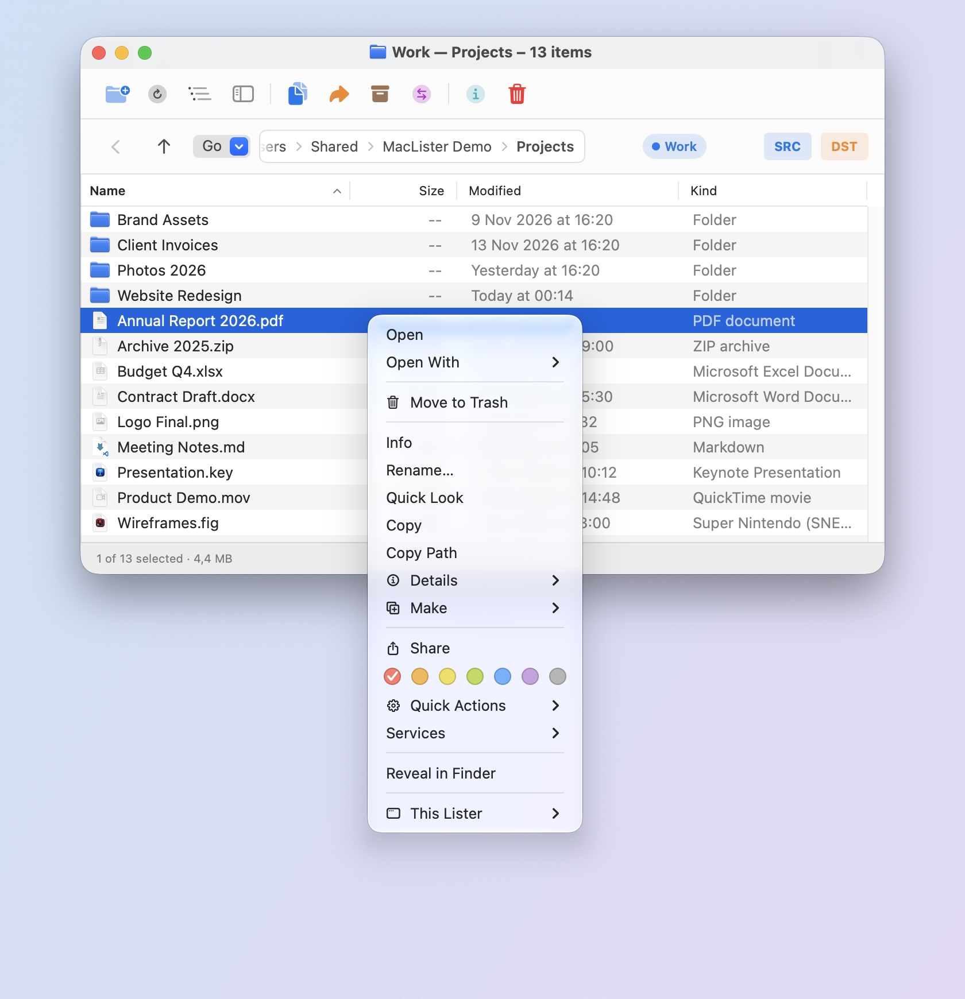
  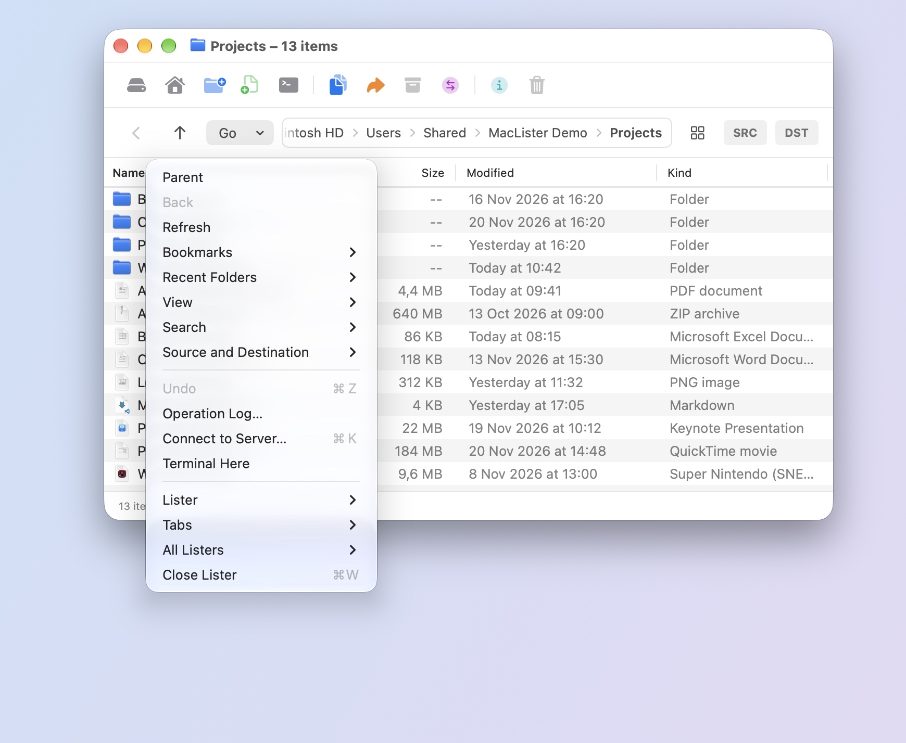
</p>

### Ustawienia

<p align="center">
  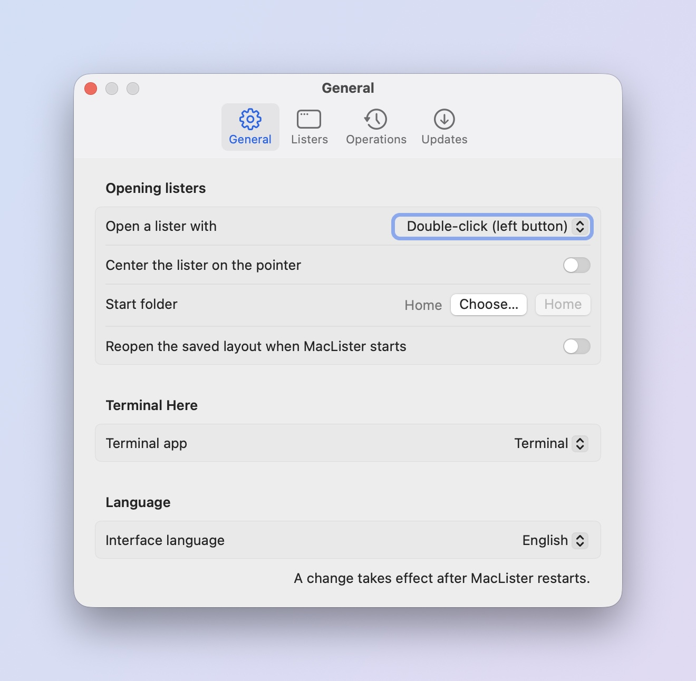
  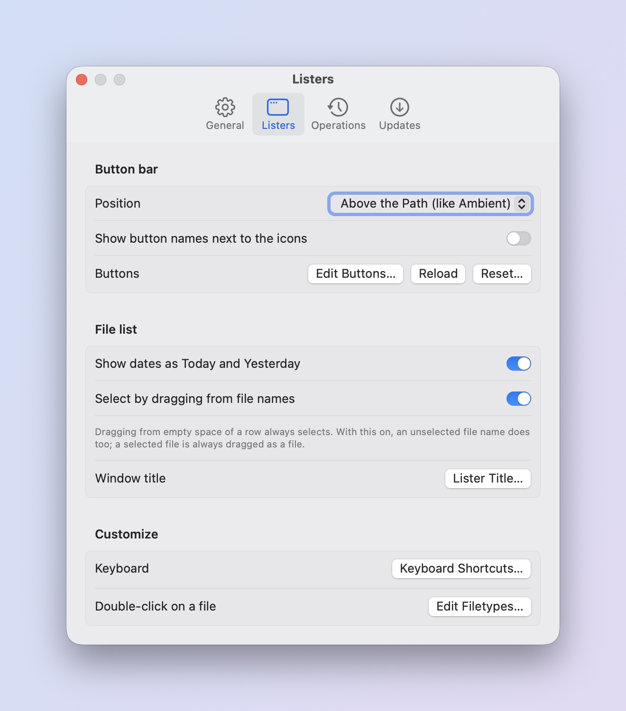
</p>

**Ikona w pasku menu → Ustawienia…** (⌘,) otwiera zwykłe macowe okno ustawień z czterema zakładkami:

- **Ogólne** — co otwiera lister (dwuklik, środkowy przycisk albo oba), wyśrodkowanie na kursorze, folder, który się
  otwiera, otwieranie zapisanego układu przy starcie, listery na wszystkich pulpitach, ikona w Docku, aplikacja
  terminala dla *Terminal Here*, edytor tekstu dla *New Text File*, język interfejsu.
- **Listery** — położenie paska przycisków i etykiety, foldery nad plikami, **Edit Buttons…** / *Wczytaj ponownie* / *Przywróć…*, daty
  względne, **karty w listerach**, otwieranie archiwów jak folderów, zaznaczanie przeciąganiem od nazw plików, **Tytuł listera…**, **Keyboard Shortcuts…**, **Edit Filetypes…**.
- **Operacje** — jak długo przechowywany jest dziennik operacji, **Otwórz dziennik operacji…** oraz **Wyczyść ostatnie
  foldery…** / **Wyczyść dziennik operacji…** (każde najpierw prosi o potwierdzenie).
- **Aktualizacje** — wersja, ostatnie sprawdzenie, automatyczne sprawdzanie (domyślnie wyłączone), *Sprawdź aktualizacje…*.

### Ikona w Docku i pulpity

MacLister domyślnie pokazuje ikonę w **Docku** (**Ustawienia → Ogólne → Pokazuj MacListera w Docku** ją wyłącza; ikona w
pasku menu zostaje w obu przypadkach). **Prawy przycisk na ikonie w Docku** pokazuje otwarte listery (kliknięcie wynosi
lister na wierzch), New Lister, Duplicate Frontmost Lister, Connect to Server…, Bring All to Front, Close All Listers,
**Przenieś wszystkie listery na ten pulpit**, Cofnij, Dziennik operacji… i Ustawienia…. Kliknięcie ikony, gdy nie ma
żadnego listera, otwiera jeden; gdy są, wynosi je wszystkie na wierzch. Przy włączonej ikonie ⌘N (menu Plik) otwiera
lister, a ⌘Tab znajduje MacListera.

**Listery na własnym pulpicie.** macOS pozwala aplikacji przenieść okna tylko na pulpit, który jest akurat widoczny.
Zatem: przejdź na wybrany pulpit (np. nowy, pusty, z Mission Control) i wybierz **Przenieś wszystkie listery na ten
pulpit** — w menu paska menu, w menu Docka, w menu listera albo globalnym skrótem ustawionym w *Keyboard Shortcuts*
(to także akcja `gatherListers` dla przycisków i klawiszy). **Ustawienia → Ogólne → Pokazuj listery na wszystkich
pulpitach** sprawia, że chodzą za Tobą wszędzie. Działa też sposób macOS: kliknij ikonę w Docku z Control → Opcje →
Przypisz do → Ten pulpit.

### Folder jako własna ikona w Docku

**Dodaj do Docka…** (menu paska tytułu → **Lister**, albo **Ten lister** w menu listy plików) wstawia folder, który
pokazuje lister, do Docka jako osobną ikonę — wygodne dla *Pobranych*, projektu albo udziału sieciowego, do którego
zaglądasz cały dzień. MacLister najpierw pyta, potem tworzy dla folderu małą aplikację w
`~/Applications/MacLister Folders` (ikona folderu z plakietką MacListera, podpisana nazwą listera) i dodaje ją do Docka,
który na chwilę się restartuje. Kliknięcie ikony otwiera lister na tym folderze albo wynosi na wierzch ten, który już
go pokazuje; MacLister uruchomi się sam, jeśli nie działa. *Tylko utwórz aplikację* pomija Dock i pokazuje aplikację w
Finderze, żebyś przeciągnął ją, gdzie chcesz. Polecenie działa dla folderów na tym Macu, nie dla serwerów, archiwów ani
list takich jak Ostatnie. Żeby usunąć ikonę, przeciągnij ją z Docka i skasuj jej aplikację. Aplikacje rozmawiają z
MacListerem przez adres `maclister://open?path=/ścieżka/do/folderu`, którego możesz używać także w skryptach
(`open "maclister://open?path=$HOME/Downloads"`).

### Czyszczenie historii

**Ustawienia → Operacje → Historia** ma **Wyczyść ostatnie foldery…** (*Recent Folders* w menu Go) i **Wyczyść dziennik
operacji…**. Obie czynności proszą o potwierdzenie i nie ruszają plików ani zakładek. Te same polecenia są na dole menu
*Recent Folders* (**Go** i menu listera) oraz w oknie dziennika operacji.

### Zaznaczanie, filtr, rozmiary

- **Zaznaczanie wzorcem** (`+`): wildcardy jak `*.jpg`, `IMG_??.png`; kilka wzorców oddzielonych spacjami;
  tekst bez wildcardów pasuje do nazw, które go zawierają. `-` odznacza, `*` odwraca.
- **Filter** (⌘F): pokazuje tylko pliki pasujące do wzorca (foldery zawsze zostają). Pusty wzorzec czyści filtr.
- **Select by Attributes** (menu kontekstowe na pustym miejscu albo przycisk): warunki na nazwę, rodzaj (obrazy,
  dźwięk, wideo, dokumenty, archiwa, foldery, pliki), rozmiar (większy / mniejszy niż) i datę modyfikacji (w ciągu
  ostatnich N dni / starsze niż N dni). Każdy ustawiony warunek musi być spełniony.
- **Sizes**: liczy rekurencyjny rozmiar zaznaczonych folderów (albo wszystkich) do kolumny Size. Pokazuje postęp
  z przyciskiem Anuluj, a na końcu sumę i zajęte miejsce na dysku. Jest też w menu kontekstowym zaznaczonych folderów.
- **Find** (⇧⌘F, menu kontekstowe na pustym miejscu, menu paska tytułu albo przycisk): przeszukuje folder i wszystko
  pod nim po nazwie (wildcardy), po **tekście wewnątrz plików**, rodzaju, rozmiarze i dacie modyfikacji. Wyniki to
  lista w tym samym listerze, jak Recents: kolumna *Where* pokazuje folder każdego pliku, a Copy, Move, Delete, Info
  i Quick Look działają na wynikach; Back wraca do folderu, z którego przyszedłeś. Wyniki pojawiają się w trakcie
  szukania, a pasek statusu ma przycisk Anuluj. **Szuka Spotlight**, gdy folder leży na woluminie, który indeksuje,
  więc MacLister nie prowadzi własnego indeksu, a szukanie w całym folderze domowym jest szybkie. Dyski sieciowe,
  woluminy bez indeksu i opcja **Przeszukaj foldery bezpośrednio** w oknie używają zwykłego przejścia po folderach
  (wolniej, znajduje też pliki ukryte i nieindeksowane; tekst jest szukany w plikach do 16 MB). Pokazuje pierwsze 5000
  trafień.
- **Find Duplicates…** (menu kontekstowe na pustym miejscu, menu paska tytułu albo przycisk): znajduje pliki o dokładnie
  takiej samej zawartości w folderze i pod nim. Pliki porównywane są najpierw po rozmiarze, potem po pierwszych 64 KB,
  a w całości (SHA-256) czytane są tylko te, które nadal wyglądają tak samo, więc duży folder jest przeszukiwany
  szybko; twarde dowiązania do jednego pliku liczą się raz. Okno pokazuje grupy, najpierw te, które marnują najwięcej
  miejsca, z polem wyboru przy każdej kopii i menu zaznaczającym wszystkie oprócz najstarszej lub najnowszej w grupie.
  **Przenieś do Kosza** działa na zaznaczone, nigdy na wszystkie kopie pliku (co najmniej jedna zawsze zostaje), trafia
  do dziennika i można je cofnąć ⌘Z.
- **Checksums…** (*Szczegóły* w menu kontekstowym plików, przycisk w oknie *Info* albo akcja `checksums`): MD5, SHA-1,
  SHA-256 i SHA-512 zaznaczonych plików, liczone w jednym przebiegu z postępem i Anuluj. Wklej otrzymaną sumę kontrolną
  w polu *Porównaj z*, a program powie, który plik i który algorytm pasują; *Kopiuj listę* wkłada do schowka wiersze
  `hash  nazwa` (format, który czyta `shasum -c`).
- **Flat View** (menu kontekstowe na pustym miejscu, menu paska tytułu albo akcja `flatView` jako przycisk): pokazuje
  wszystkie pliki z folderu i ze wszystkich podfolderów jako jedną listę (bez folderów; paczki jak `.app` zostają).
  Sortowanie, filtr, zaznaczanie i kopiowanie działają jak zwykle, *Where* pokazuje folder każdego pliku. To samo
  polecenie (*Leave Flat View*) albo Back wraca do folderu.

### Zmiana nazw, atrybuty, dowiązania

<p align="center">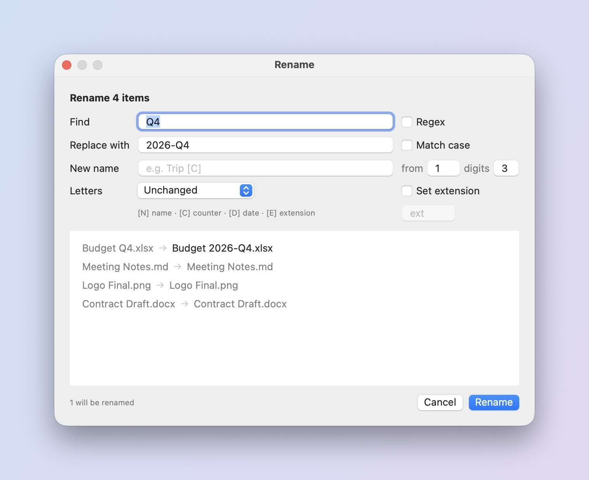</p>

- **Zmiana wielu nazw** (F2 przy kilku elementach albo *Rename N Items…*): znajdź i zamień (zwykły tekst albo
  wyrażenie regularne z `$1`, `$2`, opcjonalnie z wielkością liter), szablon nazwy z `[N]` nazwa, `[C]` licznik
  (start i liczba cyfr), `[D]` data modyfikacji i `[E]` rozszerzenie, małe / DUŻE litery / Wielkie Początki i nowe
  rozszerzenie. Podgląd pokazuje każdą parę stara → nowa nazwa, a puste nazwy, duplikaty i kolizje z istniejącymi
  plikami zaznacza na czerwono. Zmiana idzie przez nazwy tymczasowe, więc można zamieniać nazwy miejscami.
- **Atrybuty** (⌥⌘I, menu kontekstowe): uprawnienia jako siatka odczyt/zapis/wykonanie (opcjonalnie dla całej
  zawartości folderów, które zostają przeszukiwalne), daty modyfikacji i utworzenia, flaga ukrycia, tagi Findera
  i komentarz. Zmieniane są tylko włączone grupy.
- **Make Alias** i **Make Symbolic Link** (menu kontekstowe): tworzone obok oryginałów albo w folderze listera
  docelowego, jeśli jest.
- **Open With** (menu kontekstowe na plikach): aplikacje, które mogą otworzyć plik, domyślna pierwsza, albo *Other…*.

- **New Text File** (domyślny przycisk, menu kontekstowe na pustym miejscu albo *Ten lister*): tworzy pusty
  `untitled.txt` w folderze, zaznacza go i otwiera w **TextEdit**. **Ustawienia → Ogólne → Nowy plik tekstowy** pozwala
  wybrać inny edytor (Visual Studio Code, Sublime Text, BBEdit, CotEditor, Nova, Zed, TextMate, MacVim, Xcode, jeśli są
  zainstalowane, albo *Inna aplikacja…* dla dowolnej). Nowe instalacje mają ten przycisk; przy starszym `buttons.json`
  dodaj akcję `newTextFile` w *Edit Buttons…* albo użyj *Przywróć…*.

### Zakładki i historia

Menu **Go** zawiera *miejsca* (Home, Desktop, Documents, Downloads, Applications, Root, zamontowane woluminy),
*zakładki* (dodaj bieżący folder, usuń) i *ostatnie* foldery. Zakładki są w pliku `bookmarks.json`.

<p align="center">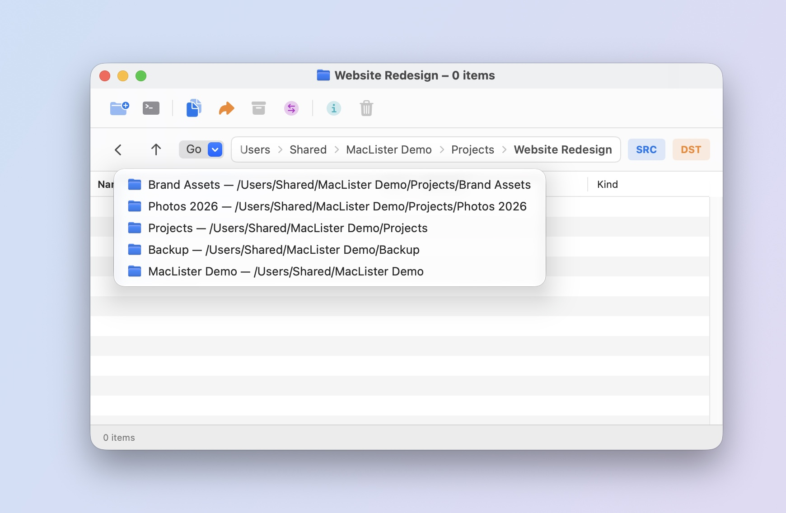</p>

**Prawy przycisk na przycisku Wstecz** (jak w Directory Opus) pokazuje foldery, z których przyszedł ten lister,
od najbliższego — wybierz jeden, żeby skoczyć od razu tam.

### Filetypes: co robi dwuklik

`filetypes.json` (**Ustawienia → Listery → Edit Filetypes…**) przypisuje akcje do rozszerzeń: `open` (domyślne
zachowanie systemu), `extract`, `quicklook`, `app` (identyfikator lub ścieżka aplikacji) i `shell` (plik jest
w `$LISTER_SELECTION`). Domyślnie archiwa są **rozpakowywane**, a nie otwierane. Przykład:

```json
[
  { "extensions": ["zip", "tar.gz", "7z", "rar"], "action": "extract" },
  { "extensions": ["md", "txt"], "action": "app", "app": "com.apple.TextEdit" },
  { "extensions": ["png", "jpg"], "action": "quicklook" }
]
```

Plik zastępuje reguły domyślne, a zmiany są wczytywane od razu.

### Układy

Ikona w pasku menu → **Save Layout** zapamiętuje każdy otwarty lister (folder, pozycję, rozmiar, rolę,
sortowanie, pliki ukryte, filtr oraz to, które listery były kartami jednego okna); **Restore Layout** otwiera je z powrotem. Automatyczne przywracanie przy starcie:

```bash
defaults write com.example.MacLister restoreLayoutAtLaunch -bool true
```

### Migawka

*Zrób migawkę tego folderu* (menu paska tytułu, *Ten lister* albo akcja `snapshot`) zapamiętuje **rozmiar i pozycję okna
oraz kolejność sortowania** dla folderu, który lister pokazuje. Wejście do tego folderu w dowolnym listerze przywraca
jego sortowanie; lister otwarty na nim dostaje jego rozmiar, a nowy lister ustawiony kaskadowo obok innego także
pozycję. Foldery bez migawki używają sortowania, które ostatnio wybrałeś klikając nagłówek kolumny. *Zapomnij migawkę*
ją usuwa. Migawki są w `snapshots.json`.

### Przeglądanie archiwów

Dwuklik na pliku zip, tar, tar.gz, 7z, rar, iso … pokazuje jego zawartość jak folder, **bez rozpakowywania** (tak jak XAD na
Amidze). MacLister czyta spis zawartości archiwum systemową biblioteką libarchive, więc nawet archiwum wielkości
kilku gigabajtów otwiera się od razu i widać każdy folder, rozmiar i datę; same pliki zostają w archiwum. Plik jest
wyciągany dopiero, gdy go używasz: otwierasz, oglądasz w Quick Look, kopiujesz (albo przeciągasz), otwierasz w aplikacji,
liczysz sumy kontrolne. Komunikat z przyciskiem Anuluj pokazuje, co jest wyciągane; folder jest wyciągany jednym
przebiegiem. Wszystko jest tylko do odczytu: pasek ścieżki i tytuł podają archiwum (`…/pack.zip/folder`), *Parent* z góry
archiwum wraca do folderu, w którym ono leży, a polecenia zmieniające archiwum (Kosz, zmiana nazwy, nowy folder,
przenoszenie z niego, upuszczanie do niego, Znajdź, Synchronizuj …) nie są oferowane albo mówią dlaczego. Archiwum
w archiwum otwiera się tak samo.

**Hasła.** **ZIP** chroniony hasłem (zwykłe szyfrowanie ZIP i AES) pokazuje listę plików od razu; pierwszy użyty plik pyta
o hasło, które jest pamiętane do zamknięcia MacListera. Systemowa libarchive nie umie odszyfrować haseł **7z i RAR**:
takie archiwa mówią o tym zamiast pytać.

To, co zostało wyciągnięte, leży w `~/Library/Caches/MacLister/Archives` (zaślepki o właściwym rozmiarze i dacie, a gdy
plik jest potrzebny, prawdziwe pliki) i jest usuwane, gdy nikt nie otwierał archiwum od dwóch dni. **Ustawienia → Listery →
Otwieraj archiwa jak foldery** wyłącza przeglądanie (wtedy decyduje reguła typu pliku, a standardowa rozpakowuje
archiwum); *Extract* rozpakowuje do folderu tak czy inaczej. Reguła typu pliku, która otwiera aplikację lub uruchamia
polecenie, nadal ma pierwszeństwo przed przeglądaniem. Formaty, których libarchive nie potrafi wylistować, są rozpakowywane
w całości przez `bsdtar`, jak dotąd.

## Serwery: FTP, FTPS i SFTP

<p align="center">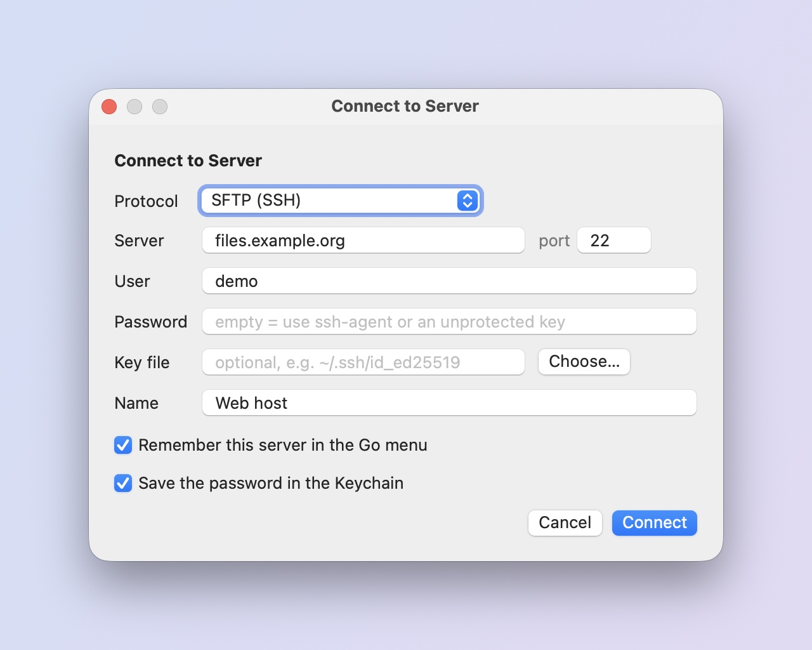</p>

Lister może pokazywać serwer jak folder. **Go → Connect to Server…** (albo ⌘K, albo ikona w pasku menu) pyta
o protokół, adres, port, użytkownika i hasło. SFTP może używać pliku klucza (i jego hasła) albo Twojego ssh-agenta.
**Remember this server** wstawia serwer do menu Go, a **Save the password in the Keychain** trzyma hasło w Pęku kluczy,
a nie w żadnym pliku.

| Protokół | Uwagi |
|---|---|
| **SFTP** (SSH) | systemowy `sftp` z OpenSSH i jedno połączenie w tle na serwer, więc logowanie dotyczy tylko pierwszej operacji |
| **FTPS explicit** (`AUTH TLS`, port 21) | systemowy `curl`; certyfikat jest sprawdzany |
| **FTPS implicit** (port 990) | to samo, TLS od pierwszego bajtu |
| **FTP** | bez szyfrowania: MacLister ostrzega, że hasło idzie jawnym tekstem |

- **Klucze serwera (SFTP):** przy pierwszym połączeniu dostajesz odciski i decydujesz, czy zaufać; są trzymane
  we własnym `known_hosts` MacLister. Jeśli klucz zaufanego serwera się zmieni, połączenie jest odrzucane.
- **Certyfikaty (FTPS):** niezaufany certyfikat jest odrzucany, chyba że zaznaczysz *Accept an untrusted certificate*
  (z ostrzeżeniem).
- **Hasła** trafiają do `curl` przez konfigurację na stdin, a do `ssh` przez `SSH_ASKPASS`; nigdy do linii poleceń.

Co działa na serwerze: przeglądanie (breadcrumb, kolumny, sortowanie, filtr, pliki ukryte, zakładki, historia,
wpisanie ścieżki albo pełnego URL), otwieranie pliku (najpierw pobiera się do cache), Quick Look, **Copy i Move między
listerem serwera a lokalnym w obu kierunkach** (listery źródłowy i docelowy, przeciąganie na serwer), Move wewnątrz
jednego serwera, **New Folder, Rename, Delete** (serwery nie mają Kosza, więc usuwanie pyta najpierw). Transfery mają
ten sam pasek postępu, Cancel i pytania o konflikty (Replace, Replace If Newer, Keep Both, Skip, Merge) co lokalne.

**Znaki wieloznaczne w nazwach SFTP:** `sftp` z OpenSSH rozwija `* ? [ ] { }` w nazwach plików i nie ma jak tego
wyłączyć, więc plik `star*.txt` mógłby dopasować też `starfish.txt`. MacLister najpierw sprawdza listę folderu:
pobranie albo listowanie, które byłoby niejednoznaczne, jest odrzucane z wyjaśnieniem, usuwanie idzie przez tymczasową
zwykłą nazwę (żeby nic innego nie ucierpiało), a nazwy z `{` lub `}` są odrzucane. Wysyłanie plików lokalnych
z takimi nazwami idzie przez tymczasowe dowiązanie.

Jeszcze nie na serwerach: atrybuty i Info, aliasy, rozpakowywanie archiwów, liczenie rozmiarów folderów, zmiana wielu
nazw, przeciąganie plików *z* listera serwera, kopiowanie między dwoma serwerami albo wewnątrz jednego, wznawianie
przerwanych transferów, automatyczne odświeżanie. Ścieżki FTP są względne do folderu logowania. Dowiązania symboliczne
na serwerze są pokazywane jako pliki; dwuklik najpierw próbuje do nich wejść. Otwarcie pliku z serwera pobiera go,
zmiany nie są odsyłane z powrotem.

## Skróty klawiszowe, które możesz ustawić

<p align="center">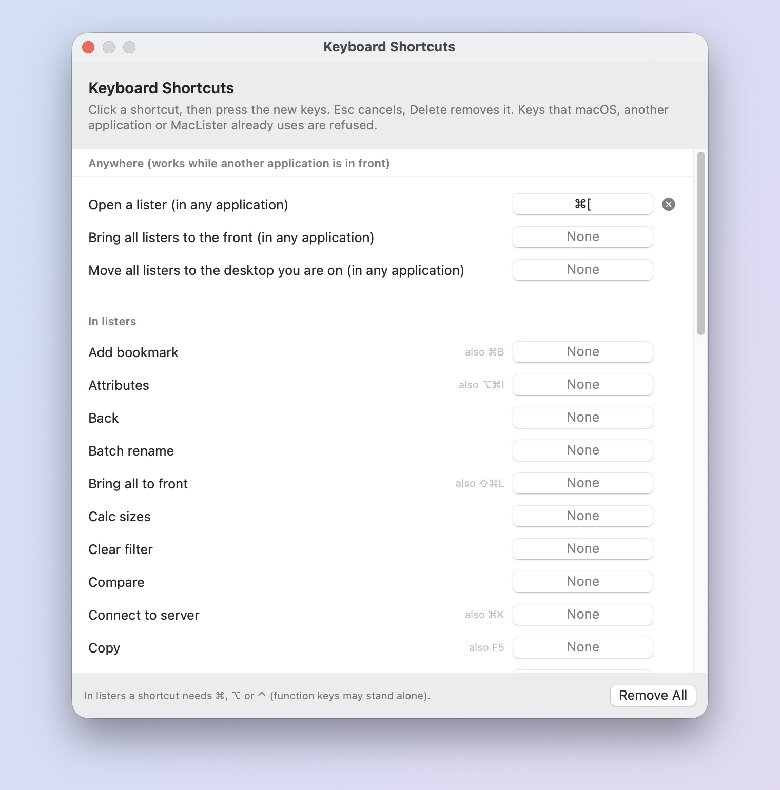</p>

**Ustawienia → Listery → Keyboard Shortcuts…** (także w menu na belce okna). Kliknij skrót i naciśnij klawisze; Esc
anuluje, Delete usuwa.

- **W każdej aplikacji:** *Open a lister* (przy wskaźniku myszy) i *Bring all listers to the front*.
- **W listerach:** osobny skrót dla każdej akcji (Copy, Move, Extract, Compare, Connect to Server, Lock Role, Select by
  Pattern …), oprócz wbudowanych klawiszy.

Każdy skrót jest sprawdzany przed przyjęciem, a okno tłumaczy, co jest nie tak:

1. wymaga ⌘, ⌥ lub ⌃ (klawisze funkcyjne i strzałki mogą stać samotnie w listerach; skróty globalne zawsze wymagają
   modyfikatora);
2. nie może być skrótem macOS: MacLister czyta włączone skróty z Ustawienia systemowe → Klawiatura → Skróty (Spotlight,
   Mission Control, zrzuty ekranu, przełączanie pulpitów …) razem z Twoimi zmianami;
3. nie może być klawiszem, który należy do każdej aplikacji (⌘Q, ⌘W, ⌘M, ⌘H, ⌘A, ⌘C, ⌘V, ⌘X, ⌘Z, ⌘Tab) ani takim,
   którego MacLister już używa;
4. skrót globalny nie może być zajęty przez inną aplikację (pytany jest system);
5. kombinacja przypisana do innej akcji pyta, czy ją przenieść.

Przypisania są w `shortcuts.json`.

## Szczegóły postępu

<p align="center">
  <picture>
    <source media="(prefers-color-scheme: dark)" srcset="docs/screenshots/transfer-details-dark.jpg">
    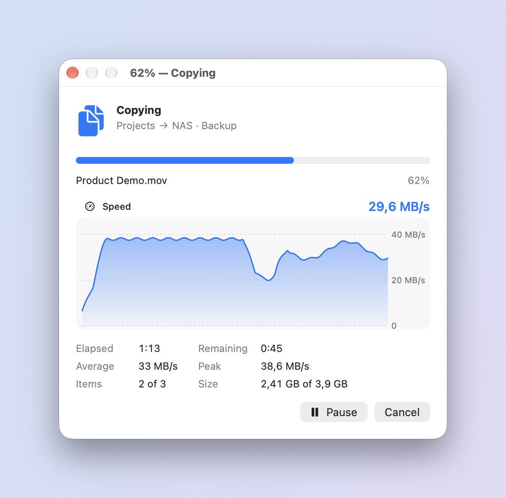
  </picture>
</p>

Pasek postępu w linii stanu listera można kliknąć: otwiera okno (macowy odpowiednik okna kopiowania z Directory Opus)
z informacją, co i dokąd jest kopiowane, paskiem postępu z bieżącym plikiem, **wykresem prędkości**, prędkością bieżącą /
średnią / szczytową, czasem, który upłynął i który pozostał, liczbą elementów i bajtów oraz przyciskami **Wstrzymaj** /
**Anuluj**. Wstrzymanie działa po zakończeniu kopiowanego pliku (jednego pliku nie da się przerwać w połowie). Prędkość
zmienia się płynnie nawet w obrębie jednego dużego pliku przy kopiowaniu lokalnym i pobieraniu; wysyłanie raportuje
plik po pliku. Tytuł okna śledzi zadanie („37% — Kopiowanie”), a po zakończeniu okno zamyka się samo.

### Ostatnie i Udostępniane

Menu **Go** zaczyna się od **Ostatnie** — plików otwieranych w ostatnich 30 dniach, od najnowszego, z danych Spotlight
(tylko dokumenty: bez folderów, programów i `~/Library`) — a miejsca kończy pozycja **Udostępniane**: zamontowane
woluminy sieciowe, serwery zapisane w MacLister i komputery oferujące udostępnianie plików w sieci lokalnej (SMB, AFP,
SFTP, FTP). Obie to listy, nie foldery: kolumna *Gdzie* pokazuje folder każdego pliku, pliki można otwierać, podglądać,
kopiować i przeciągać, ale Nadrzędny, Nowy folder, zakładki i „kopiuj do tego listera” są niedostępne. Otwarcie
komputera SMB lub AFP przekazuje go Finderowi do zamontowania; komputer SFTP lub FTP otwiera formularz *Połącz z serwerem*
z wypełnionymi polami. Pierwsza wizyta w Udostępnianych powoduje, że macOS jednorazowo prosi o dostęp do **sieci lokalnej**.

### Nazwy listerów

Gdy listerów jest wiele, warto je odróżniać: prawy przycisk na belce okna (albo na pustym miejscu listy) →
**Nazwij ten lister…** i nadaj mu nazwę oraz kolor. Nazwa pojawia się w tytule okna („NAS — Backup”), jako kolorowa
etykieta obok ścieżki (kliknięcie ją zmienia), na liście listerów w pasku menu oraz w poleceniach *Kopiuj do „NAS”* /
*Przenieś do „NAS”* — cel wybierasz więc po nazwie. Nazwy zapisują się z poleceniem *Zapisz układ*; kopia listera
nazwy nie dziedziczy. Jest też akcja `nameLister` do przycisku lub skrótu.

### Kolejka

Kopiowania i przenoszenia zapisujące na ten sam dysk (lub ten sam serwer) wykonują się jedno po drugim; kolejne
pokazują *Oczekiwanie w kolejce…* i obok paska postępu mały przycisk **W kolejce: N**, z którego można usunąć każdą z nich.
Operacje na różne dyski nadal idą równolegle. Pliki, które są kopiowane lub przenoszone (albo czekają na to), nie dadzą
się przenieść do Kosza, zmienić nazwy ani przenieść spod trwającej operacji; MacLister mówi o tym zamiast to robić.

### Foldery otwierane po najechaniu

Przytrzymaj przeciągane pliki nad folderem na liście albo nad zamkniętym folderem w drzewie przez około sekundę, a folder się
otworzy, więc możesz zanieść pliki kilka poziomów w dół jednym przeciągnięciem (wskaźnik musi spocząć; opóźnienie to
ukryte ustawienie `springLoadedDelay`, domyślnie 0,8 s). **Ustawienia → Listery → Otwieraj foldery, gdy przeciągasz nad nimi pliki**
to wyłącza.

### Zaznaczanie przeciąganiem

<p align="center">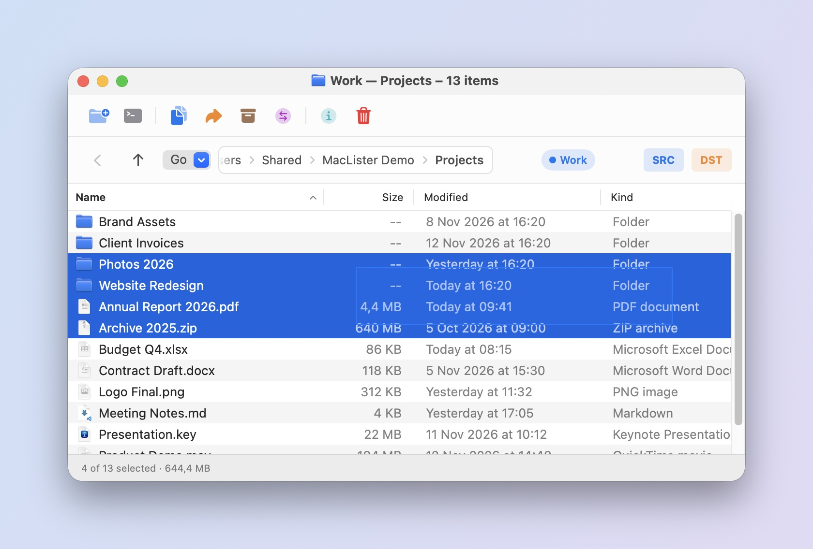</p>

Naciśnij wiersz — na jego pustej części w kolumnach Rozmiar / Data zmian albo na prawo od nazwy, albo pod ostatnim
wierszem — i ciągnij: zaznaczają się wszystkie wiersze między miejscem naciśnięcia a kursorem, jak w Directory Opus
(⌘ lub ⇧ dodaje do zaznaczenia; lista przewija się, gdy dojdziesz do krawędzi). Domyślnie działa to także od
**niezaznaczonej nazwy pliku**; naciśnięcie w dowolnym miejscu *zaznaczonego* wiersza (na nazwie albo na pustej części)
przeciąga zaznaczone pliki, więc nadal można wyciągać pliki z listera. Wolisz zachowanie
Findera (naciśnięcie nazwy zawsze przeciąga plik)? **Ustawienia → Listery → Zaznaczaj przeciąganiem od nazw plików** — wyłącz.

### Tab między listerami

**Tab** przenosi klawiaturę do następnego listera (w kolejności otwarcia), **⇧Tab** do poprzedniego. Obie rzeczy są też
akcjami (`nextLister`, `previousLister`), którym możesz przypisać inny klawisz lub przycisk.

### Karty

<p align="center">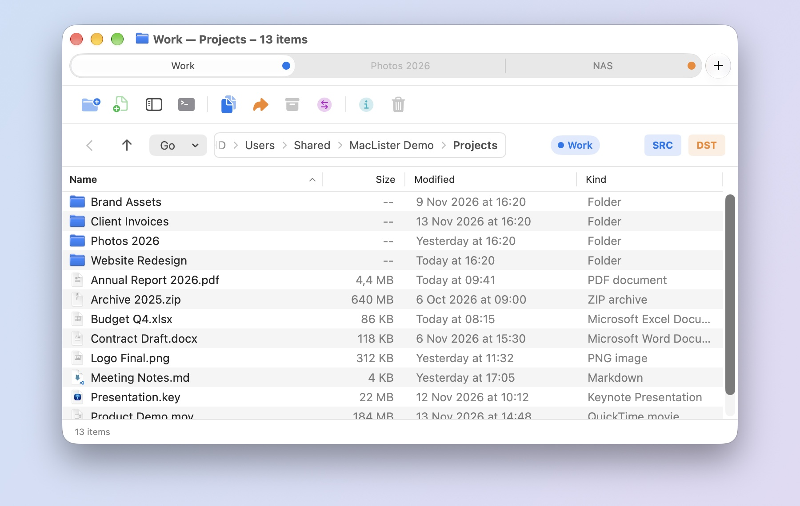</p>

Okno listera może mieścić kilka folderów jako karty, jak Finder czy przeglądarka (**Ustawienia → Listery → Zezwalaj na
karty w listerach**, domyślnie włączone; nowe listery nadal otwierają się jako osobne okna). Każda karta to pełny
lister (historia, sortowanie, filtr, zaznaczenie, drzewo folderów), więc wszystko inne działa osobno dla każdej karty.

- **⌘T** (albo **+** na końcu paska kart) otwiera bieżący folder w nowej karcie; **⌘ + dwuklik** na folderze albo
  **Otwórz w nowej karcie** z jego menu kontekstowego otwiera w niej ten folder. Pasek kart pojawia się, gdy okno ma dwie
  karty; karty można przeciągać, by zmienić kolejność, wyciągnąć poza okno (powstaje osobny lister) albo upuścić na
  innym oknie.
- **⌃Tab / ⌃⇧Tab** (albo ⇧⌘] / ⇧⌘[) przechodzą do następnej / poprzedniej karty, **⌘W** zamyka kartę. **Tab** nadal
  przechodzi między oknami listerów i pomija karty, których nie widać.
- **Nazwy.** Karta pokazuje nazwę swojego folderu i zmienia ją razem z nim. Prawy przycisk na karcie (albo na belce)
  → **Karty → Nazwij tę kartę…** albo po prostu **dwuklik na karcie** nadaje jej własną nazwę i kolor (kropka na karcie);
  nazwa zostaje, gdy karta przejdzie
  do innego folderu. *Użyj nazwy folderu* przywraca domyślną. To ta sama nazwa co w [Nazwij ten lister…](#nazwy-listerów),
  więc widać ją też w tytule i w *Kopiuj do „…”*.
  Dwuklik to ustawienie: **Ustawienia → Listery → Karty → Dwuklik na karcie** może też otworzyć nową kartę z tym samym
  folderem, zamknąć kartę albo nic nie robić.
- **Źródło i cel należą do okna.** Źródłem albo celem może być tylko karta, którą widzisz: po przełączeniu karty rola
  (wraz z blokadą) przechodzi na nową kartę, więc kopia nigdy nie trafi do folderu, którego nie widać. Po zamknięciu tej
  karty rola zostaje przy karcie pokazanej jako następna. Gdy łączysz okna, które obie miały rolę, zostaje rola
  widocznej karty.
- Menu belki ma podmenu **Karty**: Nowa karta, Nazwij / Zmień nazwę tej karty…, Następna / Poprzednia karta,
  **Przenieś kartę do nowego listera**, **Połącz wszystkie listery w karty**, Zamknij pozostałe karty. Lista listerów w
  pasku menu pokazuje karty jednego okna razem, kolejne z wcięciem.
- Akcje dla przycisków i skrótów: `newTab`, `nextTab`, `previousTab`, `moveTabToNewLister`, `mergeListers`.
- Wyłączenie opcji robi z każdej karty z powrotem osobne okno listera. Nowe listery (dwuklik na pulpicie, *Nowy lister*)
  zawsze otwierają się jako okna, także gdy w macOS ustawiono *Preferuj karty przy otwieraniu dokumentów* na *Zawsze*.

### Cofanie i dziennik operacji

<p align="center">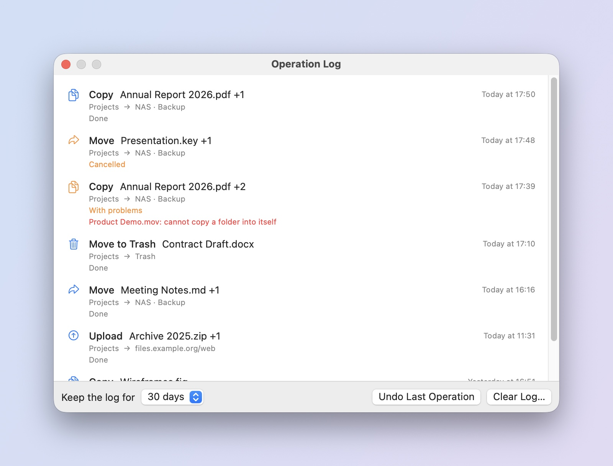</p>

**⌘Z** (albo *Cofnij…* w menu pod prawym przyciskiem i w menu paska menu) cofa ostatnie **kopiowanie,
przeniesienie, duplikowanie lub wyrzucenie do Kosza** zrobione na Twoim dysku w tej sesji, po jednej operacji, od
najnowszej:

- kopiowanie lub duplikat: nowe elementy trafiają do Kosza;
- przeniesienie lub wyrzucenie: elementy wracają tam, skąd przyszły (nigdy na coś, co tam teraz leży);
- *Zastąp* przy konflikcie: zastąpiony plik wraca z Kosza;
- scalenie folderów i wszystko na serwerze jest zapisywane w dzienniku, ale nie jest cofane.

Cofanie nigdy nie usuwa niczego na stałe. **Dziennik operacji…** (menu pod prawym przyciskiem lub menu paska menu)
wylicza każde kopiowanie, przeniesienie, wysłanie, pobranie, duplikowanie i wyrzucenie do Kosza z wynikiem, od
najnowszego. Dziennik leży w `operations.json`; **Przechowuj dziennik przez 7 / 30 / 90 dni lub rok** (domyślnie 30)
i najwyżej 1000 wpisów, więc nigdy nie rośnie bez końca. Samo cofanie jest dostępne tylko w bieżącej sesji.

### Kliknięcia przycisków i edytor przycisków

<p align="center">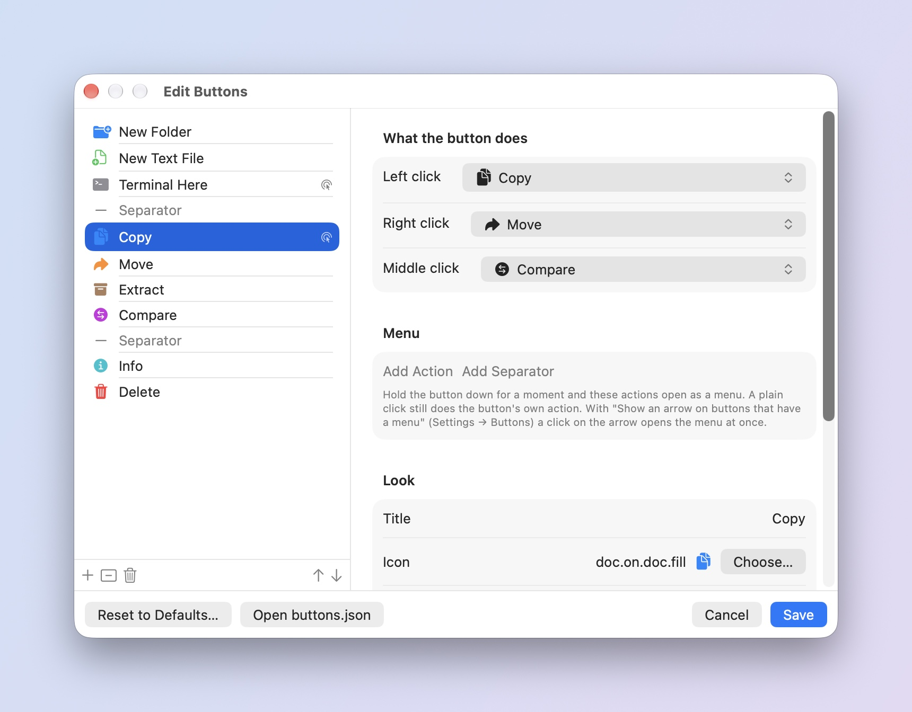</p>

Jak w Directory Opus 5, każdy przycisk może robić co innego po kliknięciu **lewym, prawym i środkowym przyciskiem myszy**.
Ikona w pasku menu → **Edytuj przyciski…**: wybierz przycisk, ustal akcję dla każdego przycisku myszy (albo polecenie
powłoki), zmień kolejność, dodaj, usuń, zmień ikonę, kolor i podpowiedź, **Zapisz**. Przyciski z dodatkowymi
kliknięciami mają znacznik w edytorze i wymieniają je w podpowiedzi. Akcję wybiera się w okienku z polem wyszukiwania,
pogrupowaną i posortowaną po nazwie. Ikona to **SF Symbol** (jedna z ikon dostarczanych z macOS; wybierz z siatki albo
wpisz dowolną nazwę) lub **własny obrazek**: *Wybierz obraz…* przyjmuje PNG, JPEG, PDF lub icns, kopiuje go (zmniejszony
do najwyżej 128 punktów) do `~/Library/Application Support/MacLister/ButtonIcons` i pokazuje taki, jaki jest, bez
koloru; nazwę pliku trzyma `iconFile` w `buttons.json`. W `buttons.json` klucze to `rightAction` /
`rightCommand` oraz `middleAction` / `middleCommand`. *Otwórz buttons.json* w edytorze otwiera surowy plik.

### Format tytułu listera

<p align="center">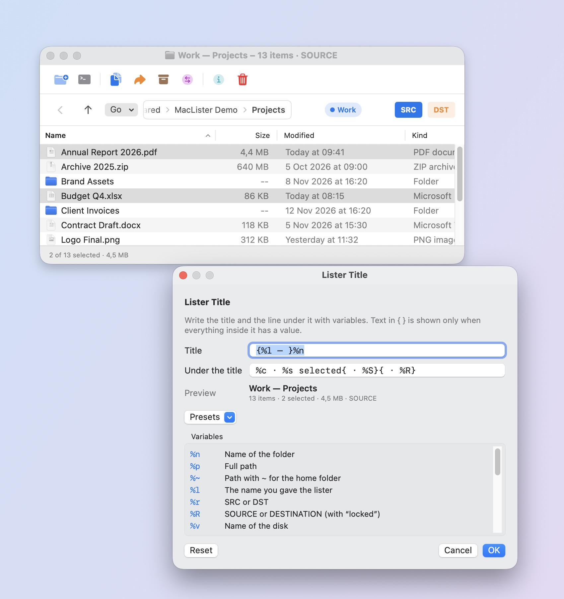</p>

**Ustawienia → Listery → Tytuł listera…** (lub menu listera) ustala, co mówi tytuł okna i linia pod nim. Pisz tekst ze
zmiennymi; **`{ … }` pojawia się tylko wtedy, gdy wszystko w środku ma wartość**, więc `{%l — }%n` to „Praca — Raporty”
dla nazwanego listera i samo „Raporty” dla pozostałych. Edytor ma podgląd na żywo, gotowe formaty i listę zmiennych:

| | | | |
|---|---|---|---|
| `%n` nazwa folderu | `%p` pełna ścieżka | `%~` ścieżka z ~ | `%l` nazwa listera |
| `%r` SRC / DST | `%R` ŹRÓDŁO / CEL | `%v` nazwa dysku | `%h` serwer |
| `%c` „11 elementów” | `%d` foldery | `%f` pliki | `%s` liczba zaznaczonych |
| `%S` rozmiar zaznaczenia | `%F` podsumowanie miejsca | `%b` wolne | `%B` pojemność dysku |
| `%m` filtr | `%t` godzina | `%D` data | `%%` `%{` `%}` znaki dosłowne |

Domyślnie: tytuł `{%l — }%n{ – %h}`, podtytuł `%c{ · %F}{ · %R}`.

### Aktualizacje

Ikona w pasku menu → **Sprawdź aktualizacje…** (albo **Ustawienia → Aktualizacje**) pyta GitHub, czy jest nowsze wydanie, i pokazuje jego opis (wraz z opisami pominiętych po drodze wersji); **Zainstaluj i
uruchom ponownie** pobiera je, sprawdza sumę SHA-256 z plikiem `.sha256` wydania i podpis kodu, po czym podmienia
aplikację i uruchamia ją (wymaga folderu instalacji, do którego możesz pisać; inaczej otwiera stronę wydania).
**Ustawienia → Aktualizacje → Sprawdzaj aktualizacje automatycznie** zagląda raz dziennie — jest **domyślnie wyłączone**, a MacLister raz po
uruchomieniu pyta, czy tego chcesz. Nic nie jest instalowane bez Twojego kliknięcia, a zapytanie nie niesie żadnych
informacji o Tobie. **Pomiń tę wersję** wycisza jedno wydanie. Adres jest w `Info.plist` (`MacListerUpdateFeed`);
`defaults write com.example.MacLister updateFeedURL <url>` go nadpisuje.

## Daty

Kolumny *Data zmian* i *Data utworzenia* mogą pokazywać daty tak jak Finder — *Dzisiaj, 10:05*, *Wczoraj …*,
*Przedwczoraj …*, starsze w pełnej postaci. Prawy przycisk na nagłówku kolumn → **Daty względne** (domyślnie włączone;
postać surowa jest o jedno kliknięcie dalej).

## Język

MacLister podąża za językiem macOS: po polsku na polskim systemie, w pozostałych przypadkach po angielsku. Wybór:
**Ustawienia → Ogólne → Język interfejsu** (*Domyślny systemowy / English / Polski*); aplikacja proponuje ponowne uruchomienie.
Teksty z liczbą mają poprawne polskie formy (1 element, 2 elementy, 5 elementów). Polecenie
`python3 Tools/check_localization.py` sprawdza, czy każdy tekst ze źródeł ma polskie tłumaczenie (`Support/pl.lproj`).

## Postęp w pasku menu

Gdy cokolwiek się kopiuje, przenosi, pobiera lub usuwa, ikona w pasku menu zamienia się w pierścień postępu z procentem
(kilka zadań: ich średnia), a podpowiedź mówi, co trwa.

## Konfiguracja

Pliki w `~/Library/Application Support/MacLister/`:

| Plik | Do czego |
|---|---|
| `buttons.json` | dolny pasek przycisków |
| `filetypes.json` | akcje dwukliku |
| `bookmarks.json` | zakładki |
| `layout.json` | zapisany układ |
| `shortcuts.json` | Twoje skróty klawiszowe |
| `servers.json` | zapisane serwery (bez haseł; te są w Pęku kluczy) |
| `known_hosts` | zaufane klucze serwerów SFTP |

### Przyciski

**Ustawienia → Listery → Edit Buttons…**; po ręcznej edycji pliku użyj obok **Wczytaj ponownie** (odświeża wszystkie otwarte listery). **Przywróć…** nadpisuje plik ustawieniami domyślnymi (użyj po aktualizacji, żeby dostać nowe przyciski;
działa też `MacLister --reset-buttons`). Domyślny zestaw jest krótki: New Folder, New Text File, Terminal Here, Copy, Move,
Extract, Compare, Info, Delete. Resztę (zaznaczanie, filtr, rozmiary, duplikowanie listera, swap …) masz w menu
i skrótach albo dodajesz jako przycisk.

```json
[
  { "title": "New Folder", "symbol": "folder.badge.plus", "action": "newFolder" },
  { "title": "Copy", "symbol": "doc.on.doc", "action": "copy", "help": "Kopiuj do celu (F5)" },
  { "title": "Code", "symbol": "chevron.left.forwardslash.chevron.right",
    "action": "shell", "command": "open -a 'Visual Studio Code' \"$LISTER_DIR\"" }
]
```

`symbol` to nazwa z SF Symbols (opcjonalnie), `color` barwi ikonę (`blue green orange red purple teal pink yellow
brown gray`; domyślnie neutralna), `help` to podpowiedź, `requiresSelection` (true/false) nadpisuje to, kiedy
przycisk jest aktywny. `{ "title": "", "action": "separator" }` rysuje cienką kreskę między grupami. **Akcje:** `newFolder terminalHere delete parent back refresh revealInFinder open
newLister toggleHidden copy move setSource setDestination swapSourceDestination extract bringAllToFront
duplicateLister duplicateFile selectPattern deselectPattern selectAll selectNone invertSelection filter
clearFilter calcSizes compare info showInDestination destinationHere addBookmark makeAlias makeSymlink selectByAttributes toggleRoleLock batchRename attributes separator shell`.
`shell` uruchamia `command` w `/bin/zsh` w bieżącym folderze; `$LISTER_DIR` to ten folder, a `$LISTER_SELECTION`
to zaznaczone ścieżki, po jednej w wierszu.

### Ustawienia ukryte

Ustawiane przez `defaults write com.example.MacLister <klucz> <wartość>`:

| Klucz | Domyślnie | Znaczenie |
|---|---|---|
| `centerOnCursor` | false | wyśrodkuj nowe listery na kliknięciu zamiast kotwiczyć róg |
| `showDockIcon` | true | ikona w Docku (także: Ustawienia → Ogólne) |
| `listersOnAllDesktops` | false | listery na każdym pulpicie (także: Ustawienia → Ogólne) |
| `showStatusItem` | true | pokaż ikonę w pasku menu (po ukryciu zamykasz aplikację z Monitora aktywności) |
| `startDirectory` | `~` | folder otwierany dwuklikiem na pulpicie |
| `terminalBundleID` | `com.apple.Terminal` | terminal dla *Terminal Here* (także: Ustawienia → Ogólne) |
| `restoreLayoutAtLaunch` | false | otwórz zapisany układ przy starcie |
| `desktopTrigger` | `doubleClick` | `doubleClick`, `middleClick` albo `both` (także: Ustawienia → Ogólne) |
| `buttonBarPosition` | `abovePath` | `abovePath`, `belowPath` albo `bottom` |
| `showButtonLabels` | false | napisy obok ikon przycisków |
| `relativeDates` | true | *Dzisiaj / Wczoraj* w kolumnach z datami (także: menu nagłówka kolumn) |
| `springLoadedFolders` | true | otwieraj folder, nad którym spoczywają przeciągane pliki (także: Ustawienia → Listery) |
| `springLoadedDelay` | 0.8 | ile sekund pliki muszą spoczywać nad folderem (od 0,2 do 5) |
| `debugHitTest` | false | zapisuj decyzję dla każdego kliknięcia do `~/Library/Logs/MacLister.log` |

## Rozwiązywanie problemów

- **Dwuklik nic nie robi.** Otwórz menu pod ikoną: jeśli widzisz *Waiting for Accessibility permission…*, nadaj oba
  uprawnienia (krok 4) i uruchom aplikację ponownie. Jeśli uprawnienia wyglądają dobrze, ale są ignorowane
  (np. po ponownej instalacji), zresetuj je i nadaj od nowa:

  ```bash
  tccutil reset All com.example.MacLister
  ```

- **Lister otwiera się na ikonie albo nie otwiera się na pustym miejscu.** Włącz `debugHitTest` i zajrzyj do
  `~/Library/Logs/MacLister.log` – każdy dwuklik zapisuje, co było pod kursorem.
- **Okna odsuwają się, a lister jest w połowie poza ekranem.** Wyłącz *Kliknij tapetę, aby odsłonić pulpit*
  (krok 6 instalacji).
- **„Terminal Here” otwiera nie tę aplikację.** Ustawienia → Ogólne → *Aplikacja terminala*.
- **Po aktualizacji brakuje nowych przycisków.** Ustawienia → Listery → Przyciski → *Przywróć…*.
- **Gatekeeper pisze, że aplikacja jest uszkodzona albo nie można jej otworzyć.** Krok 3 instalacji
  (`xattr -dr com.apple.quarantine`).

## Budowanie ze źródeł

Wymaga Xcode albo Command Line Tools (Swift 5.9+).

```bash
./build.sh                       # build/MacLister.app dla tego Maca
./build.sh release --universal   # arm64 + x86_64
./package.sh                     # wersja uniwersalna spakowana do dist/ z sumą SHA-256
```

Wbudowane samotesty prowadzą prawdziwe listery przez role, kopiowanie/przenoszenie, rozpakowywanie, menu, filtry
i więcej, a wyniki PASS/FAIL zapisują w `~/Library/Logs/MacLister.log`:

```bash
open build/MacLister.app --args --selftest
open build/MacLister.app --args --selftest-features
open build/MacLister.app --args --selftest-tabs
```

Dodaj `--quiet`, żeby test szedł, gdy pracujesz dalej: MacLister nie zabiera wtedy klawiatury, a jego okna są
niewidoczne i przepuszczają kliknięcia (nadal są prawdziwymi oknami). Uruchom sam plik wykonywalny, żeby argumenty do
niego dotarły także wtedy, gdy działa inny MacLister: `build/MacLister.app/Contents/MacOS/MacLister --selftest-features --quiet`.

Testy serwerów działają na małych lokalnych serwerach FTP/FTPS (Python ze standardowej biblioteki,
`Tools/mock_ftp_server.py`): uruchom go z `--port`, `--root` i opcjonalnie `--tls explicit|implicit --cert … --key …`,
a potem `open build/MacLister.app --args --selftest-remote ftp=2121 ftpes=2122 ftps=2123 root=<serwowany folder>`.

SFTP jest testowany na dwa sposoby: `sftpdir=<folder>` uruchamia polecenia `sftp` na systemowym lokalnym `sftp-server`
(bez sieci), a `sftp=<port> sshuser=… key=… pkey=… "pass=…" sshdir=…` na tymczasowym `sshd` uruchomionym na `127.0.0.1`
z własnymi kluczami (zaufanie do klucza serwera, pliki kluczy, hasła kluczy przez `SSH_ASKPASS`, zmienione klucze serwera).

`MacLister --open [folder]` otwiera lister przy starcie.

Ikona aplikacji jest rysowana kodem: `swift Tools/make_icon.swift` odtwarza `Support/AppIcon.icns` (dwa nakładające
się okna listerów, źródło niebieskie i cel pomarańczowy, z bramkami w stylu Amigi na zaokrąglonym kwadracie macOS).

Układ kodu: `Sources/MacLister/` – `DesktopDoubleClickMonitor` (nasłuch zdarzeń), `DesktopHitTest` (czy to puste
miejsce pulpitu?), `ListerWindowController` / `ListerManager` (okna, role), `ListerViewController` (+ `Features`)
(tabela plików i akcje), `Bars` (paski ścieżki i przycisków w SwiftUI), `FileTransfer`, `ArchiveExtractor`,
`Stores` (zakładki, historia, filetypes, układy).

## Prywatność i bezpieczeństwo

- Żeby wykryć dwuklik, MacLister czyta zdarzenia przycisków myszy w całym systemie przez **pasywny** nasłuch
  (listen-only): nie może zmieniać ani blokować Twoich danych wejściowych i ignoruje klawisze. macOS zalicza to
  do *Monitorowania wprowadzania*.
- Dostępność służy tylko do sprawdzenia, jaki element jest pod kursorem.
- Brak dostępu do sieci i telemetrii. Jedyny log to `~/Library/Logs/MacLister.log` (stan startu; kliknięcia tylko
  przy `debugHitTest`).
- Aplikacja **nie działa w sandboxie** (musi przeglądać dowolne foldery), jest podpisana ad-hoc i **bez notaryzacji Apple** (płatnej weryfikacji dla programistów).
  Dlatego nie można jej dystrybuować przez Mac App Store.
- Foldery takie jak Desktop, Documents i Downloads wywołują zwykłe pytania macOS o dostęp do plików.

## Znane ograniczenia

Serwery obsługują tylko przeglądanie, kopiowanie i podstawowe operacje na folderach (zob. *Serwery*).
Brak podglądu hex oraz wyszukiwania, duplikatów, sum kontrolnych i migawek na serwerach; archiwa są przeglądane tylko
do odczytu (nie da się ich zmieniać od środka). Przeciąganie stosuje reguły Findera. Hasła do 7z i RAR nie są obsługiwane (systemowa biblioteka ich nie odszyfruje).

## Licencja

MacLister jest udostępniony na [licencji MIT](LICENSE).
